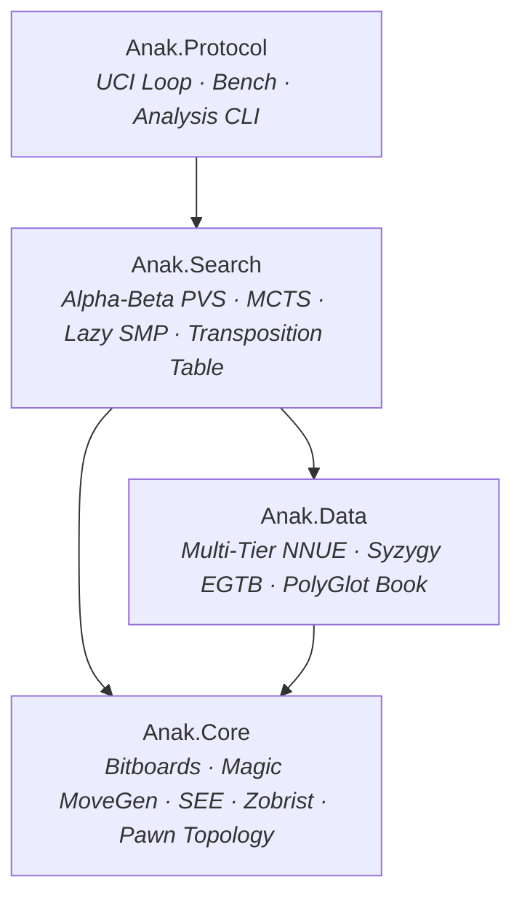
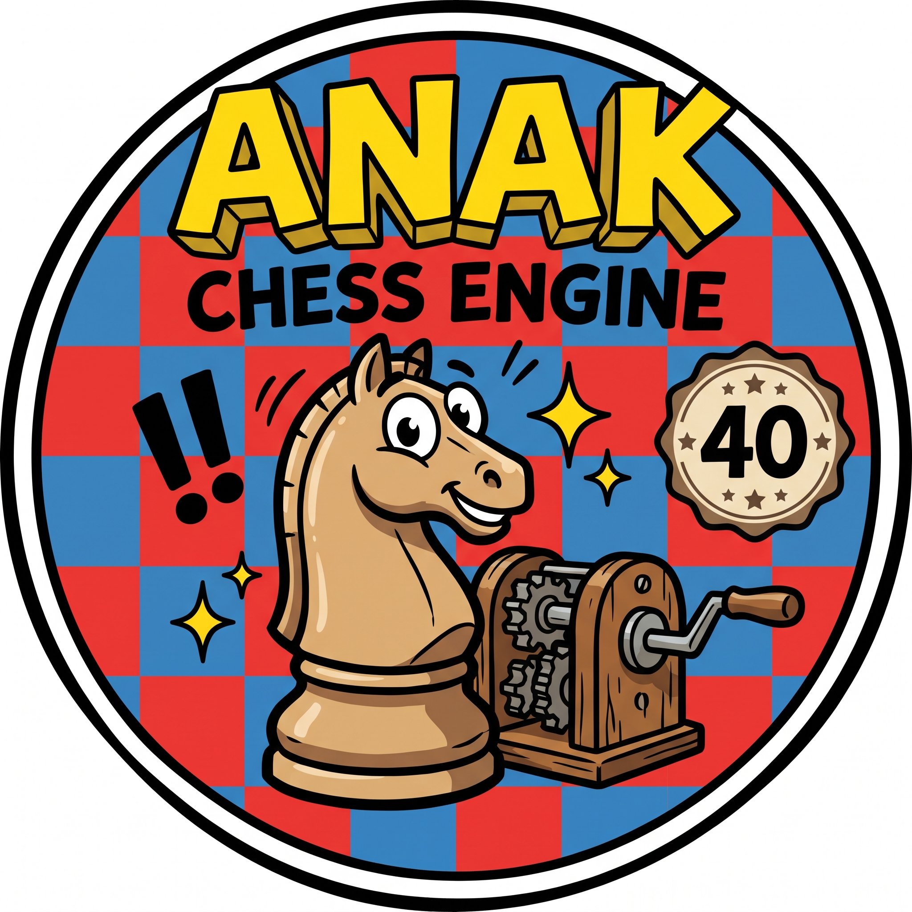

# Anak

[](https://github.com/laerens/anak/actions/workflows/ci.yml)
[](https://github.com/laerens/anak/actions/workflows/release.yml)
[](LICENSE)
[](https://dotnet.microsoft.com/)
[](BENCHMARKS.md)

**Anak** is an ultra-high-performance chess engine authored by **Laurent Aerens** (Belgium), architected for the `.NET 11` runtime (`net11.0`). It combines modern hardware SIMD intrinsics, zero-GC allocation discipline, Magic Bitboards, a tournament-grade **Alpha-Beta (Negamax / PVS)** search engine with Lazy SMP, an alternative **Monte Carlo Tree Search (MCTS)** engine, pure managed **Syzygy endgame tablebase probing**, a **PolyGlot opening book reader**, and a **Multi-Tier NNUE evaluation pipeline**.

---

## Architecture & Features



- **Dual Search Architectures**:
  - **Alpha-Beta (Minimax/PVS)** (*Default*): Fail-soft Negamax with Iterative Deepening, Aspiration Windows, Reverse Futility Pruning (RFP), Null Move Pruning (NMP), Singular/Check Extensions, Late Move Reductions (LMR), staged MovePicker with SEE, Continuation History, and lock-free Lazy SMP.
  - **Monte Carlo Tree Search (MCTS)** (*Alternative*): PUCT exploration, progressive widening, transposition DAG subtree reuse, and adaptive visit distribution.
- **Multi-Tier NNUE Evaluation**: Dynamic evaluation routing using pawn topology and position volatility across specialized quantized neural networks (`open.nnue`, `closed.nnue`, and ultra-fast `micro.nnue` / `volatility.nnue` watchdogs) evaluated via AVX2 / AVX-512 SIMD dot products.
- **Zero-GC Allocation Discipline**: Move generation and search loops run with zero heap allocations, leveraging C# `InlineArray`, compact 16-bit structs, and pre-allocated arenas.
- **Pure Managed Syzygy Tablebases**: Probing of 3-to-6 piece Syzygy WDL and DTZ tablebases implemented in 100% pure managed C# without native C/C++ dependencies. Shipped with complete 3-piece and 4-piece tables.
- **PolyGlot Opening Book Support**: Built-in `.bin` opening book reader with weighted-random, best-move, and uniform-random selection modes. Shipped with the master opening book `Performance.bin`.

---

## Downloads & CPU Architecture Selection Guide

Precompiled native single-file binaries are available on the [Releases](https://github.com/laerens/anak/releases) page for Windows, Linux, and macOS:

| Binary Asset | Architecture Target | Recommended Hardware |
|---|---|---|
| **`anak-*-x64-avx512.*`** | `x86-64-v4` (AVX-512) | **Maximum Speed**: AMD Ryzen 7000/8000/9000 (Zen 4, Zen 5), Intel 11th Gen Core, Intel Xeon Scalable. |
| **`anak-*-x64-avx2.*`** | `x86-64-v3` (AVX2 + BMI2) | **Recommended for Most PCs**: AMD Ryzen 1000–5000, Intel Core 4th–14th Gen. |
| **`anak-*-x64-generic.*`** | `x86-64-v2` (SSE4.2 + POPCNT) | **Universal Fallback**: Older PCs, budget laptops, VMs without AVX2 passthrough. |
| **`anak-macos-arm64.*`** | ARM64 (NEON) | **Apple Silicon Macs**: M1, M2, M3, M4 (Air, Pro, Max, Ultra). |
| **`anak-linux-arm64.*`** | ARM64 (NEON) | **ARM Linux**: Raspberry Pi 4/5, AWS Graviton, Ampere Altra servers. |

> [!TIP]
> If unsure, **`avx2`** works on almost all modern PCs manufactured after 2013.

---

## UCI Protocol & GUI Integration

Anak communicates using the standard Universal Chess Interface (UCI) protocol and works with any chess GUI (e.g., [Arena](http://www.playwitharena.de/), [Cutechess](https://cutechess.com/), [Banksia](https://banksiagui.com/), [Nibbler](https://github.com/rooklift/nibbler), [En Croissant](https://encroissant.org/), [ChessBase](https://chessbase.com/)).

### Key UCI Options

| Option | Type | Default | Description |
|---|---|---|---|
| `Hash` | spin | `64` | Transposition Table size in megabytes (1 to 65,536 MB). |
| `Threads` | spin | `1` | Number of concurrent search worker threads (1 to 256). |
| `SearchAlgorithm` | combo | `Minimax` | Search algorithm: `Minimax` (Alpha-Beta / PVS) or `Mcts` (Monte Carlo Tree Search). |
| `UseNnue` | check | `true` | Enables Multi-Tier NNUE neural network evaluation. |
| `NnuePath` | string | `"./networks"` | Directory containing NNUE network files. |
| `OwnBook` | check | `true` | Enables PolyGlot opening book probing. |
| `BookFile` | string | `"book.bin"` | Path to PolyGlot `.bin` opening book file. |
| `BookMode` | combo | `WeightedRandom` | Opening book move picker: `WeightedRandom`, `BestMove`, `UniformRandom`. |
| `SyzygyPath` | string | `""` | Directory containing Syzygy `.rtbw` and `.rtbz` files (defaults to `./syzygy`). |
| `SyzygyProbeDepth` | spin | `1` | Minimum search depth to probe Syzygy tablebases (1 to 100). |

*Note: Internal search heuristic thresholds (LMR, RFP, NMP, History margins) are also configurable via UCI and can be tuned using the built-in [SPSA tuner](tools/tuning/README.md).*

---

## Building & Running

### Prerequisites
- [.NET 11 SDK](https://dotnet.microsoft.com/download) (or higher)

### Build Solution
```bash
# Build the entire solution in Release mode
dotnet build Anak.sln -c Release

# Publish NativeAOT standalone binary using architecture-specific profile:
dotnet publish src/Anak.Protocol -p:PublishProfile=win-x64-avx2      # Windows AVX2
dotnet publish src/Anak.Protocol -p:PublishProfile=linux-x64-avx2    # Linux AVX2
dotnet publish src/Anak.Protocol -p:PublishProfile=osx-arm64         # macOS ARM64
```

### Run Tests
```bash
# Execute unit, perft, and search regression tests
dotnet test -c Release
```

### CLI Utilities & Benchmarks
```bash
# Run standardized engine benchmark (depth 10, 1 thread, 64 MB hash)
dotnet run --project src/Anak.Protocol -c Release -- bench

# Custom benchmark parameters: bench [depth] [threads] [hash_mb]
dotnet run --project src/Anak.Protocol -c Release -- bench 12 4 128

# Analyze a position (FEN) or PGN game file
dotnet run --project src/Anak.Protocol -c Release -- analyze --fen "r1bqkb1r/pppp1ppp/2n5/4p3/2B1n3/5N2/PPPP1PPP/RNBQK2R w KQkq - 0 5" --depth 14
dotnet run --project src/Anak.Protocol -c Release -- analyze --pgn game.pgn --depth 12

# Run Perft move generation verification
dotnet run --project src/Anak.Protocol -c Release -- --perft 5
```

---

## Bundled Assets

Anak ships ready-to-play with tournament-grade assets out-of-the-box:

1. **PolyGlot Master Opening Book (`book.bin`)**: Compiled and curated by **Marc Lacrosse** (based on `Performance.bin`), containing 92,954 master opening positions. Auto-detected in the working directory or binary root.
2. **Syzygy Endgame Tablebases (`syzygy/`)**: Complete **3-piece and 4-piece** WDL and DTZ endgame suite (70 files, 4.14 MB total) created by **Ronald de Man**. Covers all basic endgame distributions. 5- and 6-piece tables can be downloaded and referenced via `SyzygyPath`.

For full attribution and licenses, see [CREDITS.md](CREDITS.md).

---

## Developer Tooling & Documentation

- **[Elo Benchmarks & Rating Progression](BENCHMARKS.md)**: Full rating history, SPRT regression benchmarks, and automated match runner instructions (`run_elo_bench.bat`).
- **[Benchmarking & Testing Policy](docs/BENCHMARKING_POLICY.md)**: 3-Tier Testing Pyramid (Sanity Gate &rarr; SPRT Validation &rarr; Moderate Time Control) and fixed-node testing guidelines.
- **[NNUE Training Pipeline](training/README.md)**: High-speed PyTorch pipeline (>1,000,000 pos/sec), zero-copy `.binpack` memory mapping, and auto-export tools.
- **[SPSA Search Tuner](tools/tuning/README.md)**: Automated Simultaneous Perturbation Stochastic Approximation tool for search margins and heuristic tuning.
- **[Developer UI & Visualizer](tools/Anak.UI/README.md)**: Interactive desktop board visualizer with real-time search telemetry and self-play inspection (`dotnet run --project tools/Anak.UI -c Release`).

---

## Author & License



- **Author**: **Laurent Aerens** (Belgium) — [@laerens](https://github.com/laerens)
- **License**: Licensed under the **[GNU General Public License v3.0](LICENSE)** (GPLv3).
- **Credits & Acknowledgments**: See [CREDITS.md](CREDITS.md).
