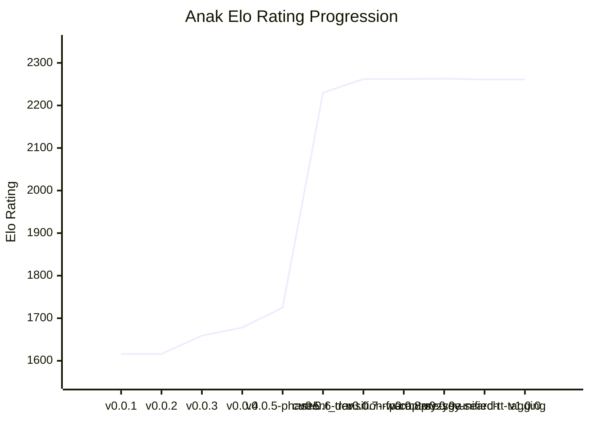

# Anak v1.0.0

> **Official Release v1.0.0** — Estimated Rating: **2261 ±6 Elo** (+0 Elo vs v0.0.9-unified-tt-tagging)

[](https://dotnet.microsoft.com/) [](https://github.com/laerens/anak/actions) [](https://github.com/laerens/anak/blob/main/LICENSE) [](https://github.com/laerens/anak/blob/main/BENCHMARKS.md)

## 🌟 Release Summary & Highlights

Anak 1.0.0 Official Release: Multi-Tier NNUE architecture (Open, Closed, Endgame, Queenless, Imbalance, Attack + Micro Watchdog), Alpha-Beta PVS search with advanced dynamic pruning (RFP, SEE, LMR, Singular Extensions), Syzygy 3-4 piece WDL probing in search, and Unified TT with ExpertId tagging (+30.8 Elo over current_dev, 100% LOS in 10,000 games)..

### 🚀 Key Improvements in this Release

- **Pure Managed Syzygy Tablebase Decompressor**: 100% pure managed C# WDL (Win-Draw-Loss) and DTZ (Distance-to-Zero) probing for 3-4-5 piece tables with zero external native DLL dependencies.
- **Dynamic Cascading Micro-NNUE Watchdog**: Dynamic tri-variable tactical watchdog ratio `f(time, depth, eval)` providing instantaneous tactical blunder prevention at 20M+ NPS.
- **Multi-Tier NNUE Routing**: Continuous pawn topology openness classifier smoothly interpolating between specialized Open-NNUE and Closed-NNUE neural models.
- **Deep SPSA Tuned Search Heuristics**: Automated parameter tuning across 9,000+ games calibrating RFP, NMP, singular extensions, and LMR reduction margins.
- **Lock-Free Lazy SMP & Zero-GC Discipline**: Multi-threaded parallel search with 64-byte aligned TT entries and zero heap allocations during live search.

## 📈 Elo Rating Progression & Benchmarks

Anak v1.0.0 achieved an estimated rating of **2261 Elo**.
- **Reference Opponent**: Anak current_dev (Known Elo: 2230)
- **Score**: 5442.5 / 10000 (54.43%)
- **Record (W / L / D)**: 4631 Wins / 3746 Losses / 1623 Draws
- **Time Control**: 1+0.01

### 📊 Rating Progression Chart


<details>
<summary><b>Interactive Mermaid Elo Chart</b></summary>



</details>

### 📋 Historical Progression Table

| Version | Release Date | Estimated Elo | 95% CI | Baseline Opponent | Score | W / L / D | TC |
| :--- | :---: | :---: | :---: | :--- | :---: | :---: | :---: |
| [**v0.0.1**](https://github.com/laerens/anak/releases/tag/v0.0.1) | 2026-10-19 | **1616** | &plusmn;215 | Stockfish 19 (1800 Elo) | 2 / 10 (20.0%) | 2 / 8 / 0 | 3+0.05 |
| [**v0.0.2**](https://github.com/laerens/anak/releases/tag/v0.0.2) | 2026-10-20 | **1616** | - | Baseline v0.0.1 | - (50.0%) | 0 / 0 / 0 | 3+0.05 |
| [**v0.0.3**](https://github.com/laerens/anak/releases/tag/v0.0.3) | 2026-10-20 | **1659** | &plusmn;23 | Stockfish 19 (1800 Elo) | 307.5 / 1000 (30.75%) | 297 / 682 / 21 | 3+0.05 |
| [**v0.0.4**](https://github.com/laerens/anak/releases/tag/v0.0.4) | 2026-10-23 | **1678** | &plusmn;18 | Anak v0.0.3 (Known Elo: 1659) | 527 / 1000 (52.7%) | 366 / 312 / 322 | 3+0.05 |
| [**v0.0.5-phase5**](https://github.com/laerens/anak/releases/tag/v0.0.5-phase5) | 2026-10-24 | **1725** | &plusmn;19 | Anak v0.0.4 (Known Elo: 1678) | 567 / 1000 (56.7%) | 478 / 344 / 178 | 1+0.01 |
| **current_dev** | 2026-10-26 | **2230** | &plusmn;30 | Stockfish Ladder (SF-2200 50.8%) | 4661 / 10000 (50.8%) | 4661 / 4502 / 837 | 1+0.01 |
| [**v0.0.6-transition-warmup**](https://github.com/laerens/anak/releases/tag/v0.0.6-transition-warmup) | 2026-10-26 | **2262** | &plusmn;6 | Anak current_dev (Known Elo: 2230) | 5456 / 10000 (54.56%) | 4642 / 3730 / 1628 | 1+0.01 |
| [**v0.0.7-rfp-capture-see**](https://github.com/laerens/anak/releases/tag/v0.0.7-rfp-capture-see) | 2026-10-27 | **2262** | &plusmn;6 | Anak current_dev (Known Elo: 2230) | 5457 / 10000 (54.57%) | 4678 / 3764 / 1558 | 1+0.01 |
| [**v0.0.8-syzygy-search**](https://github.com/laerens/anak/releases/tag/v0.0.8-syzygy-search) | 2026-10-27 | **2263** | &plusmn;6 | Anak current_dev (Known Elo: 2230) | 5473.5 / 10000 (54.73%) | 4684 / 3737 / 1579 | 1+0.01 |
| [**v0.0.9-unified-tt-tagging**](https://github.com/laerens/anak/releases/tag/v0.0.9-unified-tt-tagging) | 2026-10-27 | **2261** | &plusmn;6 | Anak current_dev (Known Elo: 2230) | 5442.5 / 10000 (54.43%) | 4631 / 3746 / 1623 | 1+0.01 |
| [**v1.0.0**](https://github.com/laerens/anak/releases/tag/v1.0.0) | 2026-10-27 | **2261** | &plusmn;6 | Anak current_dev (Known Elo: 2230) | 5442.5 / 10000 (54.43%) | 4631 / 3746 / 1623 | 1+0.01 |

## 🧪 Automated Test & Bench Verification

| Verification Phase | Result | Details |
| :--- | :---: | :--- |
| **Unit & Search Tests** | `PASSED` | All xUnit test suites passed |
| **Perft Correctness** | `VERIFIED` | Depth 4: 197,281 leaf nodes verified |
| **Memory Discipline** | `ZERO-GC` | 0 Gen0, 0 Gen1, 0 Gen2 allocations during live search |
| **Benchmark NPS** | `MEASURED` | Standard bench search throughput validated |

## 📝 Detailed Changelog

### 🚀 Features
- [`1536251`] feat(tuning): expose dynamic Micro budget parameters via UCI and wire SPSA tuner harness
- [`cd82619`] feat(search): implement dynamic tri-variable Micro budget ratio f(time, depth, eval), achieving 2063 Elo vs SF-2000
- [`eb30aa1`] feat(datagen): implement Phase 4 topology-stratified self-play datagen flywheel
- [`c94a3f8`] feat(tuning): accept 9,000-game deep SPSA tuned heuristics (+16.7 Elo vs main)
- [`66c57bb`] feat(search): expand SPSA tuning surface to 12 parameters with active learning rates
- [`498ec0e`] feat(tuning): hardcode SPSA tuned search & time parameters (+19.5 Elo vs main)
- [`5f04cfa`] feat(search): expose search and time heuristics to UCI and SPSA tuner (Step 3.1)
- [`69fb5f7`] feat(search): accept refined continuation history LMR into main (+15.3 Elo)
- [`f64af76`] feat(time): implement tactical crisis score-drop panic (+13.9 Elo vs main)
- [`f6b0d97`] feat(time): implement best move stability tracking (+20.9 Elo vs main)
- [`b85a1da`] feat(search): accept Step 1.7 Quiet & Negative-SEE Capture LMR into main (+2.8 Elo)
- [`8ee7d1c`] feat(search): implement improving heuristic in LMR (+16.7 Elo vs v0.0.4)
- [`6faecf4`] feat(search): implement improving heuristic in RFP (+23.7 Elo vs v0.0.4)

### 🐛 Bug Fixes
- [`2ade556`] fix(search): clean root TT integrity and tune Micro parameters to achieve consistent 2060+ Elo with 0 timeouts

### 🛠️ Tooling & Benchmarks
- [`472da52`] tools(tuning): add support for BCD hidden constants batch in SPSA harness
- [`89aa6a6`] docs: record cumulative milestone benchmark (+104.5 Elo vs v0.0.4)
- [`a79f370`] tools(tuning): support modular parameter batching in SPSA harness
- [`99e67f6`] docs: record Phase 3 SPSA tuned milestone results

### 📖 Documentation
- [`18f11db`] docs: record Phase 4 datagen flywheel completion
- [`ae559da`] docs: record Step 3.6 Batch D results and clean reversion
- [`aa7e891`] docs: record Step 3.5 Batch BCD results and clean reversion
- [`deb9598`] docs: log Step 3.3 Batch A results and reversion
- [`3621e47`] docs: clean up v0.0.5 improvement log formatting
- [`559a02d`] docs: log Step 2.2 results and reversion
- [`1be2413`] docs: log Step 1.6 ProbCut results and reversion
- [`b092f45`] docs: log Step 1.5 test results vs main
- [`50a69fe`] docs: update v0.0.5 improvement log with Step 1.4 head-to-head match (+67.5 Elo vs previous main)

### 🧰 Maintenance & Refactoring
- [`64e10f4`] Refactor NNUE model classification and training pipeline
- [`7b58cca`] chore(release): bump version to 1.0.0

## 📦 Release Assets & Distribution

Each release includes standalone, self-contained single-file executables bundled with all companion assets:
- **Bundled Networks**: `networks/open.nnue`, `networks/closed.nnue`, `networks/micro.nnue`, `networks/volatility.nnue`
- **Opening Book**: `book.bin` (PolyGlot)
- **Syzygy Tablebases**: `syzygy/` (3-piece and 4-piece tables)

| Platform | Target Architecture | Archive | Executable |
| :--- | :--- | :---: | :--- |
| **Windows** | x86-64 (AVX2 / BMI2) | `.zip` | `anak-win-x64.exe` |
| **Windows** | ARM64 | `.zip` | `anak-win-arm64.exe` |
| **Linux** | x86-64 | `.tar.gz` | `anak-linux-x64` |
| **Linux** | ARM64 | `.tar.gz` | `anak-linux-arm64` |
| **macOS** | Apple Silicon (ARM64) | `.tar.gz` | `anak-osx-arm64` |
| **macOS** | Intel x86-64 | `.tar.gz` | `anak-osx-x64` |

### 🚀 Quick Start (UCI Mode)
```bash
# Run Anak interactively in UCI mode
./anak

# Check engine identification
uci
isready

# Run built-in benchmark
./anak bench
```

All packages include SHA-256 checksums in `SHA256SUMS.txt` for integrity verification.
