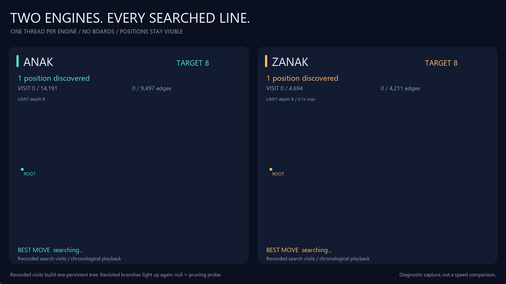

# Zanak v0.0.3 — Balanced Crosspoint Priority & Time-Control Scaling Profile

**Zanak** is an experimental chess engine in the Anak repository built around **ZAP (Zero-branching Accelerated Probe)**.



---

## Highlights in `v0.0.3`

* **Finite Ply-1 Refutation Bias (`ZapParams`, `ZapWorkQueue`):** Replaced the hard `1L << 40` `ImmediateRefutationClass` barrier with a finite, tunable `ImmediateRefutationBonus` (`350`). Ply-1 adversarial refutations still keep a strong first-batch head start over routine deeper nodes, while high-value spines' ply-2 crosspoints and large deeper shocks can now preempt low-value ply-1 work.
* **Uncapped Above-Shock Malus (`ZapParams`, `ZapWorkQueue`):** Added `CrosspointAboveShockMalusWeight` (`100`%). In both `EnqueueTrajectory` and `EnqueueSubspine`, `ZapWorkQueue` tracks the highest raw `responsibility` seen above each ply (`maxResponsibilityAbove`) and subtracts it from deeper crosspoints' `ShockMagnitude` so broken/noisy tops are resolved before spending work below them, while clean spines surface naturally.
* **Unit Tests (`ZapWorkQueueTests`):** Updated `WorkQueue_ImmediateRefutation_PrecedesModerateDeeperCrosspoint` and `WorkQueue_ImmediateRefutation_YieldsStrictPrecedenceAfterFirstBatch`, and added `WorkQueue_HighValueOrLargeShockDeeperCrosspoint_PreemptsLowValueImmediateRefutation` and `WorkQueue_HighShockAbove_PenalizesDeeperCrosspoints`.

---

## Verification & Time-Control Elo Profile

* **Unit Tests:** `dotnet test -c Release -- xUnit.ParallelizeTestCollections=false` — **408 / 408 passed** (`0` failures, `0` skipped).
* **Matches vs `Stockfish-1320` (`UCI_LimitStrength=true`, `UCI_Elo=1320`, `Threads=1`, `openings.epd`):**

| Time Control | Games | Score | W-L-D | Elo vs SF-1320 | Est. Elo | LOS |
|---|---:|---:|---:|---:|---:|---:|
| `1+0.01` | 100 | 62.50% | 61-36-3 | `+88.74 ± 74.89` | **~1409** | 99.32% |
| `5+0.05` | 50 | 38.00% | 17-29-4 | `-85.04 ± 96.78` | **~1235** | 3.24% |
| `10+0.1` | 30 | 36.67% | 11-19-0 | `-94.94 ± 179.23` | **~1225** | 11.32% |

```text
Est. Elo
1410 | *  (1+0.01: ~1409)
1360 |  \
1310 |   \
1260 |    \
1210 |     *-------*  (5+0.05: ~1235 -> 10+0.1: ~1225)
     +--------------------
       1+0.01  5+0.05  10+0.1
```

Zanak is comfortably ahead of `Stockfish-1320` in fast bullet (`1+0.01`), drops off between `1+0.01` and `5+0.05` as minimax reaches depth `14–18` on multi-move combinations, and flattens out between `5+0.05` and `10+0.1`.
