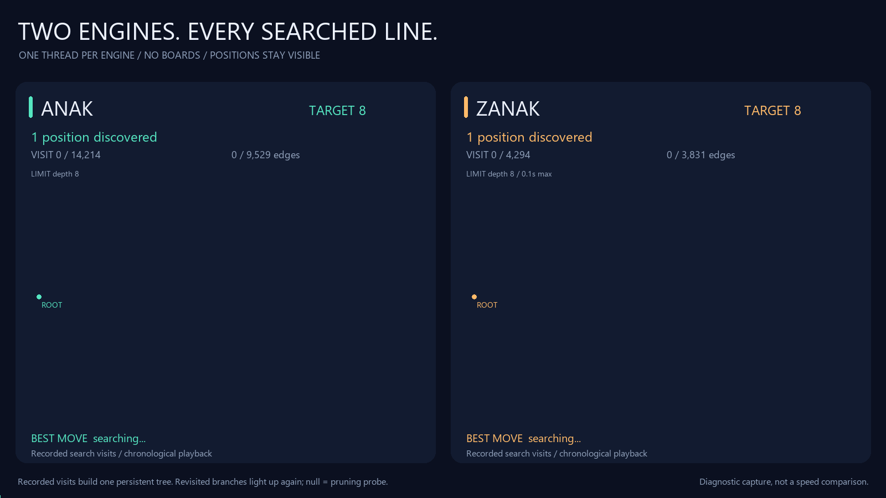
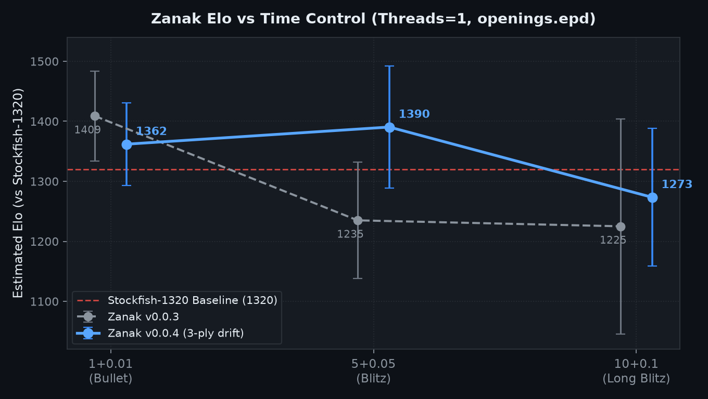

# Zanak v0.0.4 — 3-Ply Rolling-Drift Crosspoint Detection

**Zanak** is an experimental chess engine in the Anak repository built around **ZAP (Zero-branching Accelerated Probe)**.

---

## Highlights in `v0.0.4`

* **3-Ply Rolling-Drift Crosspoint Signal (`ZapParams`, `ZapWorkQueue`):**
  * Added `DriftThresholdCp` (`65` cp) to `ZapParams`.
  * In `ZapWorkQueue.ComputeResponsibility`, any 3-ply window `[j .. j+2]` where no individual ply triggered a single-ply shock (`blame[j] == blame[j+1] == blame[j+2] == 0`), `Gain(steps[j]) <= 0`, and the cumulative 3-ply eval drop reaches `DriftThresholdCp` now flags `blame[j]` with `netDrop`.
  * Catches slow multi-move positional squeezes in blitz/longer time controls without adding branching to `ZapProbe` or extra per-step work to `ZapPolicy`.
* **Unit Tests (`ZapWorkQueueTests`):** Added `Responsibility_DetectsSlowThreePlyDrift_WithoutSinglePlyShock`.

---

## Verification & Time-Control Elo Profile

* **Unit Tests:** `dotnet test -c Release -- xUnit.ParallelizeTestCollections=false` — **409 / 409 passed** (`0` failures, `0` skipped).
* **Matches vs `Stockfish-1320` (`UCI_LimitStrength=true`, `UCI_Elo=1320`, `Threads=1`, `openings.epd`):**

| Time Control | Games | Score | W-L-D | Elo vs SF-1320 | Est. Elo | LOS |
|---|---:|---:|---:|---:|---:|---:|
| `1+0.01` | 100 | 56.00% | 52-40-8 | `+41.89 ± 69.02` | **~1362** | 88.83% |
| `5+0.05` | 50 | 60.00% | 28-18-4 | `+70.44 ± 101.42` | **~1390** | 92.55% |
| `10+0.1` | 30 | 43.33% | 13-17-0 | `-46.60 ± 114.91` | **~1273** | 20.18% |

