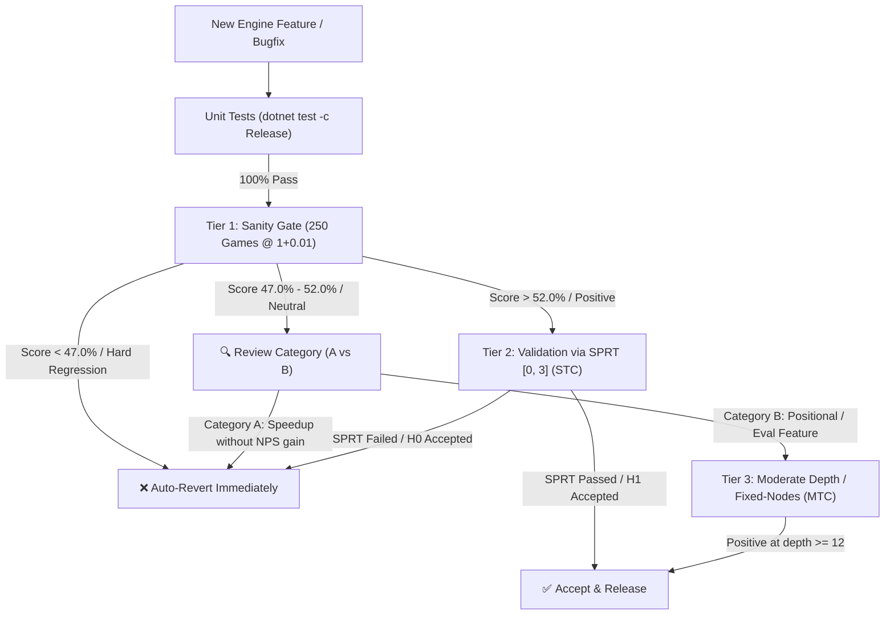

# Anak Benchmarking, Elo Evaluation & Testing Guide

> **Target Audience:** Engine developers, contributors, and maintainers.  
> **Related Files:** [`AGENTS.md`](../AGENTS.md) (strict AI rules), [`docs/v1.0.x-improvement-plan.md`](v1.0.x-improvement-plan.md) (current experiment log).

---

## 🎯 The Core Philosophy: Balancing Consistency, Compute & Real-Life Strength

In chess engine development, testing is often caught in a three-way tug-of-war:
1. **Consistency:** Not accepting noise, regressions, or false positives.
2. **Compute Budget:** Avoiding burning 3–4 hours of 100% CPU on every speculative change, draining laptop batteries, or causing thermal throttling.
3. **Real-Life Playing Strength:** Ensuring that optimizations don't just win at ultra-bullet (1+0.01 at depth 9), but translate into real Elo gains at tournament blitz and rapid depths (depth 14–22).

To solve this, Anak uses a **3-Tier Testing Pyramid** combined with **Feature Categorization** and **Fixed-Node testing options**.

---

## 🏛️ The 3-Tier Testing Pyramid



### 1. Tier 1: Quick Sanity Gate (250 Games)
- **Time Control:** `1+0.01` or `nodes 50000`
- **Execution Time:** ~3.5 to 4 minutes on 8 cores.
- **Purpose:** Rapid filter to detect broken logic, tactical blunders, search blowups, or game-losing bugs before investing heavy compute.
- **Decision Rules:**
  - **Hard Regression ($< 47.0\%$, $<-20\text{ Elo}$, LOS $< 15\%$):** **Reject and revert immediately.**
  - **Neutral / Flat ($47.0\% - 52.0\%$):** **Do NOT auto-reject.** In 250 games, the $95\%$ confidence interval is $\pm 40\text{ Elo}$. A score of $49.8\%$ is statistically neutral, not proven bad. Check the feature category:
    - *Category A (tactical/speed):* If NPS didn't increase, abort.
    - *Category B (positional/depth):* Graduate to Tier 2 SPRT or Tier 3 MTC.
  - **Positive ($> 52.0\%$):** Advance to Tier 2.

### 2. Tier 2: Validation via SPRT (Sequential Probability Ratio Test)
- **Engine Command:**
  ```bash
  python tools/fastchess/run_elo_bench.py --baseline <active_baseline> --sprt 0.0 3.0 --max-games 8000 --tc 1+0.01 --concurrency 8
  ```
- **Why SPRT instead of blind 10,000 games?**
  - **Early Winner Acceptance:** If a candidate provides a solid $+15\text{ Elo}$ boost, SPRT reaches statistical certainty ($95\%$ confidence) in **1,500 to 2,500 games** and stops automatically.
  - **Early Loser Rejection:** If a candidate is negative, SPRT detects the failure and terminates in **800 to 1,200 games**.
  - **Compute Savings:** Across 10 development iterations, SPRT cuts total compute time and battery consumption by **60% to 70%** compared to forcing a full 10,000 games every run.

### 3. Tier 3: Moderate Time Control (MTC) & Fixed-Node Gate
- **Scope:** Reserved for features whose impact only expresses at depth $\ge 12$ (correction history, singular extensions, 2-ply/4-ply continuation history, endgame tablebases).
- **Time Control:** `3+0.03` or `5+0.05` (500–1,000 games) or fixed nodes (`nodes 100000`).

---

## ⏱️ Tackling the "Timeset Issue" (Wall-Clock vs. Fixed Nodes)

When evaluating chess engines on personal hardware (laptops, desktops with variable background load, or machines with battery power management), **wall-clock time controls (`1+0.01`) introduce two major sources of distortion**:

### Distortion 1: Thermal & Battery Throttling
- When a laptop transitions from wall power to battery, or when the CPU hits thermal throttling thresholds, CPU clocks drop by 20–40%.
- A match run on battery might search at 180k NPS, while the same build on desktop searches at 340k NPS. This creates inconsistent Elo benchmarks between machines.

### Distortion 2: Ultra-Shallow Depth Overfitting
- At `1+0.01`, search only reaches **depth 8–11** (~200k nodes per move).
- Optimizing purely for `1+0.01` can lead to "bullet overfitting": heavily favoring ultra-aggressive pruning that blunders at depth 15, while penalizing positional corrections that need depth to accumulate.

### 🛠️ The Solution: Fixed-Node Testing (`nodes <N>`)
When testing on laptops, battery power, or across different machines, replace wall-clock time with **Fixed-Node Testing**:
```bash
python tools/fastchess/run_elo_bench.py --baseline v1.0.6 --games 500 --nodes 50000 --concurrency 8
```
- **100% Hardware Independent:** Every single move searches the exact same number of nodes regardless of whether your laptop is throttled, plugged in, or running background apps.
- **Deterministic Evaluation:** Eliminates clock jitter, OS thread scheduling noise, and GC pauses from match results.
- **Direct Search Efficiency Measurement:** A stronger engine at fixed nodes is mathematically proven to have higher node quality (better pruning, better move ordering, and better evaluation).

---

## 🏷️ Feature Categorization Guide

Before launching a test, classify the candidate into its natural domain:

| Category | Typical Features | Natural Search Depth | Primary Validation Path |
| :--- | :--- | :---: | :--- |
| **Category A: Speed & Tactical Pruning** | Mailbox arrays, bitboard chains, flattened history, shallow SEE pruning, move picker stages | Depth 8–12 | Tier 1 Sanity &rarr; Tier 2 SPRT (1+0.01 or nodes 50k) |
| **Category B: Positional & Search Depth** | Pawn correction history, 2-fold repetition, singular extensions, endgame tablebases | Depth 13–20 | Tier 1 Sanity &rarr; Tier 3 MTC (3+0.03 or nodes 100k) |

---

## 💻 CLI Quick-Reference for Developers

```bash
# 1. Run full unit test suite (always required before testing)
dotnet test -c Release

# 2. Run a fast 250-game Tier 1 Sanity Check vs baseline
python tools/fastchess/run_elo_bench.py --baseline v1.0.6 --games 250 --tc 1+0.01 --concurrency 8

# 3. Run a deterministic Fixed-Node Sanity Check (laptop/battery safe)
python tools/fastchess/run_elo_bench.py --baseline v1.0.6 --games 250 --nodes 50000 --concurrency 8

# 4. Run an SPRT Validation Match (stops automatically when proven)
python tools/fastchess/run_elo_bench.py --baseline v1.0.6 --sprt 0.0 3.0 --max-games 8000 --tc 1+0.01 --concurrency 8

# 5. Run a Moderate Time Control (MTC) match for Category B features
python tools/fastchess/run_elo_bench.py --baseline v1.0.6 --games 500 --tc 3+0.03 --concurrency 6
```
