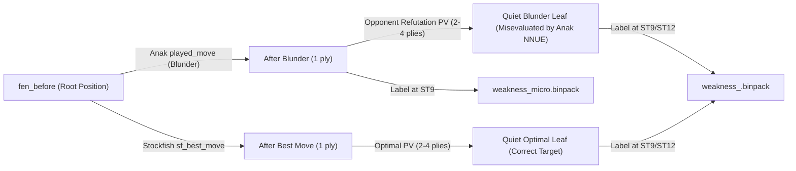
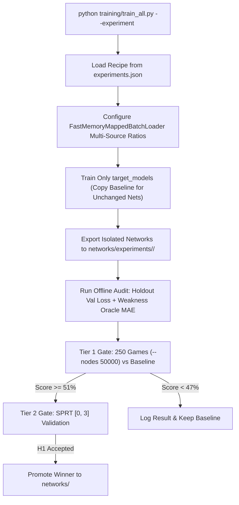

# Anak Multi-Expert NNUE ("Nets Per Position") — Training & Experiment Roadmap

This document captures the architectural audit, data-generation upgrades, weakness-analysis feedback loops, tactical puzzle integration, and the design for a **Single-Argument Experiment Runner** (`--experiment`) prior to the next major NNUE training run.

---

## 1. Pre-Training Verification Checklist (`MicroNNUE` & Data Filters)

> [!IMPORTANT]
> Verify on the main training PC that the local fix covers **both** the PyTorch forward pass/exporter and the C++20 binpack unpacker before starting a multi-hour run.

### 1.1 `MicroNNUE` King-Bucket Alignment (`model.py` / `export.py` / `NnueWeights.cs`)
- **The Issue:**
  - In `training/model.py`, `MicroNNUE.__init__` initializes `self.ft = nn.Linear(FEATURE_COUNT, hidden_dim)` with `FEATURE_COUNT = 12,288` (`16` king buckets $\times$ `768`).
  - If `MicroNNUE.forward()` clamps raw indices (`[0..767]`) without calling `map_raw_indices_to_buckets()`, PyTorch only updates bucket `0` (`[0..767]`), leaving buckets `1..15` (`93.75%` of the feature transformer) at random initialization.
  - Meanwhile, `NnueWeights.LoadFromFile` in C# inspects the file size (`196,608` bytes $\ge 16 \times 768 \times 16$) and sets `Buckets = 16`, causing `NnueAccumulator.ComputeFull` to read those untrained buckets whenever a king is outside bucket `0`.
- **Verification / Fix Options:**
  - **Option A (16-Bucket Micro):** Call `map_raw_indices_to_buckets()` in `MicroNNUE.forward()` and `simulate_csharp_micro()` in `training/export.py`, and write `KING_BUCKETS` into the `export_micro` header.
  - **Option B (1-Bucket L1-Cache Micro — Recommended for Speed):** Use `RAW_FEATURE_COUNT = 768` (`Buckets = 1`, `12 KB` total footprint) in `MicroNNUE.__init__` so the entire Micro network fits inside L1 data cache and never requires king-bucket refreshes.

### 1.2 `micro.binpack` Check & Capture Inclusion (`sf_binpack_to_anak.cpp`)
- **The Issue:**
  - In `AlphaBetaEngine.cs`, `EvaluateMicro` is called **only** after opponent checks, captures, or promotions (`if (inCheck || oppMove.IsCapture || oppMove.IsPromotion)`) to test if `rootMicro - (-oppMicro) > 280 cp`.
  - However, `training/cpp_binpack/sf_binpack_to_anak.cpp` skips all `in_check` positions (`if (in_check) continue;`) and only appends to `b_micro` inside `if (!is_capture)`.
- **Fix:**
  - Allow `in_check` and `is_capture` positions to flow into `b_micro` and `b_vol` inside `sf_binpack_to_anak.cpp` while keeping the 6 primary quiet-eval experts (`open`, `closed`, `endgame`, `queenless`, `imbalance`, `attack`) restricted to `!in_check && !is_capture`.

---

## 2. Closing the Weakness-Analysis Loop (Hard-Example Mining)

Currently, `tools/anak_weakness_finder/export_training_fens.py` exports `.epd` files, whereas `training/train_all.py` trains exclusively on `.binpack` files unpacked from generic Stockfish self-play. Bridging this gap turns every weakness campaign into a self-improving training cycle.

### 2.1 Root vs. Leaf Blindness: Unrolling the Blunder & Refutation PVs
- **Problem:** `oracle_analyzer.py` currently evaluates and stores `fen_before` (the root position *before* Anak played its blunder). However, Anak chose `played_move` because its leaf evaluation **2–6 plies down the blunder branch** (after the opponent's refutation) was overly optimistic. Training only on `fen_before` does not fix the leaf node that fooled the alpha-beta search.
- **Solution (Subtree PV Unrolling):**
  For every qualifying failure in DuckDB (`plies` / `weakness_training_data`):
  1. **The Blunder Trajectory (Negative Leaf Anchors):** Start at `fen_before`, push `played_move` (Anak's blunder), and step `1..4` plies along Stockfish's refutation PV until reaching a quiet/non-check position. Label with Stockfish `d9`/`d12` eval so the active expert learns that the resulting board state is lost.
  2. **The Optimal Trajectory (Positive Leaf Anchors):** Start at `fen_before`, push `sf_best_move`, and step `1..4` plies along Stockfish's best PV. Label with Stockfish `d9`/`d12` eval so the expert learns the true value of the correct continuation.



### 2.2 Filtering Mate-Score Saturation
- In `weakness_report.md` (Section 13), many top `eval_error` rows are forced mates (`Anak Eval: -98.00` vs `ST9: +99.00`). Feeding `±99.0` pawns into `ModernNNUELoss` saturates the sigmoid and distorts Huber gradients.
- **Filter Rule:** Restrict weakness training exports to non-mate positions where `|sf9_eval_pawns| <= 12.0` and `|anak_eval - sf9_eval_pawns| >= 1.20`.

### 2.3 Targeting the Black Color Disparity (`-11.7%`) & "Cracked Defense" (`4.64x`)
- `weakness_report.md` (Sections 2, 3, 11) shows Black scores `56.7%` vs White's `68.4%`, with **Cracked Defense (`Equal -> Loss`) occurring 4.64x more often as Black** (`4,201` vs `905`), heavily concentrated in Sicilian, French, and King's Indian structures.
- **Remediation:** Query DuckDB `plies` for Black positions where `anak_eval` was between `-0.30` and `-1.50` prior to a collapse, evaluate those defensive tension states with Stockfish `d9`/`d11`, and oversample them in `closed.binpack`, `open.binpack`, and `imbalance.binpack`.

---

## 3. Tactical Puzzles for `Micro-NNUE` & Specialist Nets

### 3.1 Lichess Puzzle Database Ingestion (`lichess_db_puzzle.csv.zst`)
The open Lichess puzzle corpus (~4M puzzles with `FEN`, `Moves`, `Rating`, and `Themes`) maps directly onto Anak's multi-tier architecture without requiring expensive engine searches:

| Extracted Puzzle State | Board State Description | Target Network(s) | Training Objective |
| :--- | :--- | :--- | :--- |
| **State 0 (`FEN`)** | Pre-blunder tense position | `volatility`, active expert | High volatility target (`vol >= 6.0`) |
| **State 1 (`+Moves[0]`)** | Opponent just blundered; tactic available | `micro`, `volatility` | Side-to-move has winning tactical shot (`+eval`) |
| **State 2 (`+Moves[1]`)** | First refutation move (check/capture/fork) played | `micro` | **Exact state evaluated by `AlphaBetaEngine` line 839** (`-eval`) |
| **State K (`+Moves[end]`)** | Quiet post-tactic aftermath | `imbalance`, `endgame`, `attack` | Clean material/positional conversion evaluation |

### 3.2 Pairwise Watchdog Margin Loss (`BlunderLoss` Upgrade)
- In `AlphaBetaEngine.cs`, the Micro watchdog triggers a refutation when:
  $$\text{EvaluateMicro}(\text{rootBoard}) - (-\text{EvaluateMicro}(\text{boardAfterReply})) > 280\text{ cp}$$
- Adding a **Pairwise Margin Ranking term** to `BlunderLoss` on `(State 0, State 2)` puzzle pairs directly trains `MicroNNUE` to produce a $> 3.0\text{ pawn}$ drop across the 2-ply blunder-refutation transition, calibrating the network to the exact `280 cp` search threshold.

### 3.3 Theme-Guided Routing into Full Experts
- Puzzles tagged `kingsideAttack`, `queensideAttack`, `attackingF2F7`, `sacrifice`, `clearance` $\rightarrow$ route to `attack.binpack`.
- Puzzles tagged `endgame`, `rookEndgame`, `bishopEndgame`, `pawnEndgame`, `knightEndgame`, `queenEndgame` $\rightarrow$ route to `endgame.binpack` and `queenless.binpack`.

---

## 4. Maximizing "Nets Per Position" (Multi-Expert Refinements)

### 4.1 Eliminating the Expert Handoff Cliff (3.11 Switches / Game)
- **Diagnostic Finding (`weakness_report.md` Section 7):** Anak switches NNUE experts in `94.5%` of games (average `3.11` switches/game). Blunders spike sharply at phase handoffs:
  - `Attack -> Endgame`: **23.53%** blunder rate
  - `Queenless -> Imbalance`: **22.75%** blunder rate
  - `Open -> Endgame`: **16.72%** blunder rate
  - `Imbalance -> Endgame`: **13.09%** blunder rate
- **Root Cause:** During search, `_activeFullWeights` is pinned to the root board's expert. When the root has `17` pieces (`Imbalance` or `Open`), 15–16 piece leaf nodes inside the search tree are evaluated by the middlegame expert. Once a trade occurs on the board (`16` pieces), the next root switches to `Endgame`, whose centipawn offset/scale may differ by `50–150 cp`, causing evaluation whiplash.
- **Fixes:**
  1. **Transition-Band Data Overlap:** In `sf_binpack_to_anak.cpp`, duplicate boundary positions across adjacent experts so both nets agree on transition leaves:
     - `15 <= pieces <= 19` $\rightarrow$ write to **both** `endgame.binpack` AND the active middlegame expert (`open`, `closed`, `imbalance`, `queenless`).
     - `material_imbalance in [3, 5]` $\rightarrow$ write to **both** `imbalance.binpack` AND `open`/`closed`.
     - `0.44 <= openness <= 0.54` $\rightarrow$ write to **both** `open.binpack` AND `closed.binpack`.
  2. **Cross-Expert Boundary Anchor Loss:** Maintain a small shared validation/anchor buffer of `~25,000` boundary positions and penalize divergence from the true Stockfish centipawn scale across all 6 models.

### 4.2 Piece-Count Stratified `endgame.binpack` (Fixing the 73.9% Endgame Loss Share)
- **Diagnostic Finding (`weakness_report.md` Sections 4 & 10):** `73.9%` of all losses occur in `Endgame Attrition (Ply > 60)`, with `Bishop Endgame` (`37.6%`) and `Rook & Pawn` (`47.3%`) underperforming.
- **Root Cause:** In raw Stockfish `d9` binpacks, 13–16 piece positions outnumber 5–9 piece positions by $>10\times$. Unbounded unpacking fills `endgame.binpack` mostly with 14–16 piece positions.
- **Fix:** Enforce stratified sub-quotas inside `endgame.binpack`:
  - **35% Early Endgame:** `13..16` pieces
  - **40% Technical Endgame:** `8..12` pieces (with 2x priority on `Rook + Pawn` and `Bishop + Pawn`)
  - **25% Deep Endgame:** `4..7` pieces (preferring `d11` archives)

### 4.3 Widening `attack.binpack` Beyond Strict Opposite-Side Castling
- **Diagnostic Finding (`weakness_report.md` Section 9):** `Attack` has the lowest middlegame win rate (`53.1%`) because strict opposite-side castling occurs in a small fraction of games, starving `attack.binpack` of diverse king-safety patterns.
- **Fix:** During training data unpacking, include same-side castling positions with king-zone pawn storms or open files over the enemy king into `attack.binpack` (even if runtime `ExpertRouting` remains strict), giving `attack.nnue` much richer king-safety representations.

---

## 5. Single-Argument Experiment Framework (`--experiment`)

To systematically test different training data mixes across **one, several, or all NNUE nets** without manual file juggling, we can introduce a declarative experiment runner into `training/train_all.py`.

### 5.1 CLI UX Design (Single Argument)
Run a single experiment, a comma-separated list, or an entire sweep with one flag:
```bash
# Run a single named experiment (trains only the target net(s) and benchmarks vs baseline)
python training/train_all.py --experiment exp01_endgame_stratified

# Run multiple experiments sequentially and produce a comparative Elo/Loss table
python training/train_all.py --experiment exp01_endgame_stratified,exp02_weakness_hard_mining,exp03_micro_puzzles

# Run all defined experiments overnight
python training/train_all.py --experiment all
```

### 5.2 Declarative Experiment Schema (`training/experiments/experiments.json`)
Each experiment defines:
1. **`target_models`**: Which subset of the 8 NNUEs to train (`["endgame"]`, `["micro", "volatility"]`, `["imbalance", "endgame"]`, or `["all"]`). Untrained models are symlinked/copied from the current active baseline so multi-expert interactions are tested fairly.
2. **`data_recipe`**: Exact mixture weights across data sources per model:
   - `sf_d9`: Standard Stockfish Depth-9 binpack share
   - `sf_d11`: Deep Stockfish Depth-11 binpack share
   - `cross_expert_mix`: Cross-domain regularization share from the other 5 experts
   - `boundary_overlap`: Transition-zone positions (`15..19` pieces, `0.44..0.54` openness)
   - `weakness_hard`: Oracle-relabeled `weakness_<expert>.binpack` (blunder & refutation leaves)
   - `lichess_puzzles`: Tactical puzzle states (`micro`, `volatility`, `attack`, `endgame`)
3. **`hyperparameters`**: Optional overrides for `lambda_wdl`, `eval_scale`, `lr`, `epochs`, or `blunder_weight`.
4. **`isolated_output`**: Exports `.pt` checkpoints to `checkpoints/experiments/<exp_id>/` and `.nnue` files to `networks/experiments/<exp_id>/` (protecting production `networks/*.nnue` until promoted).
5. **`auto_eval`**: Automatically runs:
   - Offline validation loss + centipawn MAE on the holdout test set + Oracle Weakness test suite.
   - Tier 1 Sanity Gate (`250` games at `--nodes 50000` via `run_elo_bench.py` passing the experiment's network directory).
   - Optional Tier 2 SPRT (`[0.0, 3.0]`) for candidates scoring $\ge 51.0\%$ in Tier 1.



---

### 5.3 Catalog of Concrete Experiments to Run

Below is a structured progression of **8 experiments**—ranging from single-net surgical fixes to full-fleet mixtures—designed to isolate exactly what adds Elo:

| Exp ID | Scope (`target_models`) | Hypothesis & Goal | Data Mix Recipe | Key Hyperparameters |
| :--- | :--- | :--- | :--- | :--- |
| **`exp01_micro_puzzles`** | `micro`, `volatility` | Fixing king-bucketing + adding checks, captures, and Lichess puzzles makes the 1-ply watchdog catch tactical traps cleanly. | `40%` SF quiet/tactical + `40%` Lichess Puzzles (States 1 & 2) + `20%` Weakness throws | `BlunderLoss(weight=6.0)` + Pairwise margin |
| **`exp02_endgame_stratified`** | `endgame`, `queenless` | Stratifying piece counts + heavy Depth-11 data fixes the `73.9%` endgame attrition loss rate (`Rook & Pawn`, `Bishop`). | `30%` SF d9 (`13..16` pcs) + `45%` SF d11 (`6..12` pcs) + `15%` Endgame Puzzles + `10%` Boundary (`15..19` pcs) | `lambda_wdl=0.45` (higher WDL weight for endgame conversion) |
| **`exp03_handoff_bridge`** | `imbalance`, `open`, `endgame` | Overlapping boundary positions (`15..19` pcs, `imbalance 3..5`) eliminates the `13%–23%` blunder spike on expert switches. | `65%` Primary Expert + `20%` Transition Boundary Overlap + `15%` Global Mix | Cross-expert scale anchor Huber term (`0.10`) |
| **`exp04_weakness_oracle`** | `open`, `closed`, `imbalance`, `endgame` | Injecting Oracle-relabeled blunder leaves & optimal PVs fixes recurring blindspots and Black's `4.64x` cracked defense rate. | `75%` Primary SF d9/d11 + `15%` Global Mix + `10%` `weakness_<expert>.binpack` (2–4 ply PV rollouts) | `lr=5e-4` (or fine-tune from baseline for 25 epochs) |
| **`exp05_attack_kingstorm`** | `attack` | Expanding `attack.binpack` with same-side king storms and attacking puzzles lifts `Attack` from its `53.1%` floor. | `50%` Opposite-Castling SF + `25%` Same-Side King-Attack SF + `15%` Lichess Attack Puzzles + `10%` Global Mix | `eval_scale=2.25` (sharper king-safety sensitivity) |
| **`exp06_wdl_pure_eval`** | `open`, `closed` | Testing lower `lambda_wdl` (`0.15` vs `0.35`) so middlegame nets trust deep Stockfish centipawn evals over noisy game outcomes. | `80%` Primary SF d9/d11 + `20%` Global Mix | `lambda_wdl=0.15`, `eval_scale=2.50` |
| **`exp07_black_defense`** | `closed`, `open`, `imbalance` | Oversampling slightly-worse defensive positions (`-0.4` to `-1.8` pawns) in Sicilian/French/KID closes the `-11.7%` Black gap. | `70%` Primary SF + `20%` Defensive Equalizer Slice (`eval in [-1.8, -0.3]`) + `10%` Black Weakness Cracked Defenses | Standard (`lambda_wdl=0.30`) |
| **`exp08_grand_combined`** | `all` (All 8 Models) | Combines the winning recipes from `exp01`–`exp07` into a unified 8-model production training run. | Full stratified d9/d11 + `15%` Transition Overlap + `10%` Weakness PV Leaves + Lichess Puzzles for Micro/Attack/Endgame | Best per-model hyperparameters from `exp01`–`exp07` |

### 5.4 Fast Fine-Tuning Mode (`--from-baseline`) for Rapid Experiment Iteration
- Training all 8 models from scratch on `30M` positions takes hours, whereas **testing a new data mix via fine-tuning** (`--from-baseline --epochs 15 --lr 2e-4`) takes **under 10 minutes per experiment**!
- The `--experiment` runner can default to a **2-Stage Protocol**:
  1. **Stage A (Screening via Warm-Start Fine-Tuning):** Load `checkpoints/<model>_best.pt`, train for `15` epochs on the experiment's data mix at `lr = 2e-4`, export to `networks/experiments/<exp_id>/`, and run a `250`-game fixed-node match (`--nodes 50000`).
  2. **Stage B (Full Training of Winners):** Any experiment recipe that passes Stage A is automatically queued for a full `80–100` epoch run from scratch (or merged into `exp08_grand_combined`).
