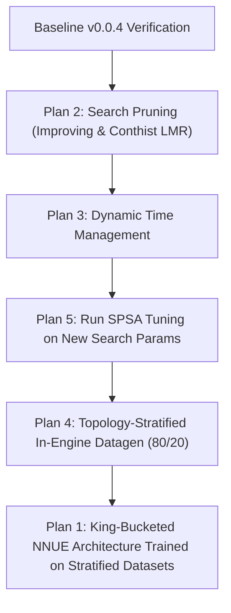

# Anak Engine Enhancement Roadmap: 5 Core Improvement Plans

This document details five concrete, actionable implementation plans to systematically elevate Anak's Elo rating beyond the `v0.0.4` milestone.

---

## 🗺️ High-Level Overview & Impact Matrix

| Plan | Focus Area | Estimated Elo Gain | Complexity | Prerequisites |
|---|---|:---:|:---:|---|
| **Plan 1** | **King-Bucketed NNUE (`HalfKA_v2` / 16 Buckets) + $SCReLU$** | **+150 to +250** | Medium-High | PyTorch pipeline & C# SIMD accumulators |
| **Plan 2** | **Advanced Search Pruning (Improving, ProbCut, Conthist LMR)** | **+50 to +80** | Low-Medium | Existing `AlphaBetaEngine.cs` |
| **Plan 3** | **Dynamic Time Management & Move Stability** | **+20 to +40** | Low | `TimeManager.cs` |
| **Plan 4** | **Topology-Stratified Multi-Domain Datagen Flywheel (80/20 Mixture)** | **+70 to +120** | Medium-High | Fast search & binary pack streaming |
| **Plan 5** | **Automated Parameter Tuning (SPSA)** | **+25 to +45** | Low | `tools/tuning/spsa.py` & fastchess |

---

## Plan 1: King-Bucketed NNUE Architecture & $SCReLU$

> [!IMPORTANT]
> ### The Micro-Tier Exemption: Why Both `micro.nnue` & `volatility.nnue` Stay on Raw 768
> Anak features two lightweight micro-tier networks sharing the $768 \to 16\times 2 \to 1$ architecture:
> 1. **`micro.nnue` (Tactical Watchdog & Blunder Sentry)**: Fast blunder filter checking leaf nodes and deep tactical candidates.
> 2. **`volatility.nnue` (Tactical Sharpness & Tension Predictor)**: Dynamically gauges position volatility / eval swings in $[0, 1000]$ to scale search selectivity and NMP caution.
> 
> **Both micro-models must remain on the raw 768 piece-square architecture for three critical reasons:**
> - **Blistering Throughput (~20–30M NPS)**: Their 16-neuron hidden dimension fits exactly into a single AVX2 256-bit register (`Vector256<short>`).
> - **Zero Accumulator Refresh Overhead**: King-bucketing requires refreshing the entire 16-piece accumulator whenever a king moves across bucket boundaries. For micro-evals executing millions of times per second in tight loops, zero bucket-transition overhead is vital.
> - **Permanent L1 CPU Cache Residency**: Each micro-model's weights total only ~25 KB. Both `micro.nnue` and `volatility.nnue` fit simultaneously inside L1 data cache (typically 32–48 KB per core). Adding 16 king buckets would inflate them $16\times$ (~400 KB each), evicting them into L2/L3 cache and gutting execution speed.
> - **Domain Fit**: Tactical blunders and board sharpness are 95% governed by piece contact and immediate squares, not long-term king safety geometry. King buckets are reserved exclusively for the primary evaluation expert(s).

### 1. Architectural Design for Primary Expert(s)
* **Input Feature Representation**:
  $$\text{Feature}(K, P, S) = (\text{KingBucket}(K) \times 768) + (P \times 64 + S)$$
  Where $K$ is the friendly king square, $P$ is piece type & color ($0..11$), and $S$ is square ($0..63$).
* **16 King Buckets with Horizontal Symmetry**:
  Mirror files E–H to A–D for White and Black kings so the network learns symmetric king safety:
  $$\text{FoldedSquare} = \text{File}(sq) \ge 4 \ ? \ (sq \oplus 7) : sq$$
  Compressing 32 king squares on ranks 1–4 into 16 distinct king safety zones.
* **Activation Upgrade**:
  Replace linear $CReLU(x)$ with Squared Clipped ReLU ($SCReLU$):
  $$SCReLU(x) = (\text{clamp}(x, 0, 1.0))^2$$
  In C# AVX2, this maps to a single `_mm256_mulhi_epi16` or `_mm256_mullo_epi16` operation, capturing second-order piece synergies.

### 2. Implementation Steps
1. **Python Training Update (`training/model.py`, `training/train.py`)**:
   - Add `KingBucketedNNUE` with input dimension $16 \times 768 = 12,288$.
   - Implement warm-start routine copying trained 768-weights into each of the 16 bucket slices.
   - Add $SCReLU$ forward pass with scaling.
2. **C# Evaluation Engine (`NnueConstants.cs`, `MultiTierNnueEvaluator.cs`)**:
   - Register new architecture ID `ArchKingBucketed = 0x0003`.
   - Update `AccumulatorStack`:
     - Regular moves: delta add/sub on active bucket only.
     - King move within same bucket: delta move on king piece.
     - King move crossing bucket boundary: refresh accumulator for the moving side from active bitboards.
3. **Verification**:
   - Unit tests verifying accumulator incremental updates match full refresh after any sequence of moves.
   - Benchmark NPS impact (refresh overhead should remain $< 3\%$ of search time).

---

## Plan 2: Advanced Search Pruning & Reductions

### 1. The "Improving" Heuristic
* **Formula**:
  ```csharp
  bool improving = !inCheck && ply >= 2 && staticEval > _stack[ply - 2].StaticEval;
  ```
* **Search Integration**:
  - **Reverse Futility Pruning (RFP)**:
    If improving, require higher margin (`RfpMargin * depth * 1.3`) before pruning; if not improving, prune aggressively.
  - **Null Move Pruning (NMP)**:
    If improving, increase reduction $R$ or require higher beta margin.
  - **Late Move Reductions (LMR)**:
    If not improving, increase reduction by 1 ply ($r++$).

### 2. Continuation History Conditioned LMR
* Currently LMR uses butterfly history alone. Combine with 1-ply and 2-ply continuation history:
  ```csharp
  int combinedHistory = _history.GetScore(side, move) 
                      + 2 * _continuationHistory.Get1PlyScore(...) 
                      + _continuationHistory.Get2PlyScore(...);
  if (combinedHistory > 4000) r--;
  else if (combinedHistory < -4000) r++;
  ```

### 3. ProbCut (Probability Cutoff)
* At depth $\ge 5$, non-PV nodes, if static eval $\ge \beta + 200$:
  - Search captures at depth $depth - 4$ with window $[\beta + 200, \beta + 201]$.
  - If any capture beats this elevated window, immediately return $\beta$.

### 4. Capture LMR (Quiet & Bad Captures)
* For captures that do not gain material (SEE $\le 0$) searched late in the move order (move index $> 4$), apply $1$-ply reduction instead of searching at full depth.

### 5. Implementation Steps
1. Modify [`AlphaBetaEngine.cs`](file:///c:/Users/laerens/source/repos/Personal/anak/src/Anak.Search/Minimax/AlphaBetaEngine.cs) to track `StaticEval` in `_stack[ply]`.
2. Add `improving` calculation right after static evaluation.
3. Add ProbCut probe block before standard move picker.
4. Run regression suite (`dotnet test`) and benchmark with `run_elo_bench.bat`.

---

## Plan 3: Dynamic Time Management & Move Stability

### 1. Mechanics
* **Best Move Stability**:
  Track how many consecutive iterative deepening iterations selected the same root move:
  - If best move is stable for $\ge 4$ depths: decrease time scale to $0.8\times$.
  - If best move flips at depth $\ge 8$: multiply soft time limit by $1.8\times$ (up to hard limit).
* **Node Share / Early Termination**:
  - If best move has accumulated $> 80\%$ of all root nodes searched, and score did not drop: break iterative deepening early.
* **Score Drop Panic**:
  - If score drops by $> 50$ centipawns compared to the previous depth, extend time limit by $2.0\times$ to resolve the tactical crisis.

### 2. Implementation Steps
1. Update [`TimeManager.cs`](file:///c:/Users/laerens/source/repos/Personal/anak/src/Anak.Search/Time/TimeManager.cs) with `UpdateMoveStability(Move currentBest, int score, ulong nodes)`.
2. Integrate stability check into `AlphaBetaEngine.RunMainSearch` loop between depth completions.
3. Calibrate on Cutechess matches with time controls `3+0.05` and `10+0.1`.

---

## Plan 4: Topology-Stratified Multi-Domain Datagen Flywheel

> [!IMPORTANT]
> ### Beyond Generic Self-Play: Advanced Stratified Generation & the 80/20 Rule
> Generating random self-play positions produces an over-representation of standard symmetrical quiet midgames and severely starves expert models of rare but critical topologies (endgames, locked chains, opposite-side pawn storms, queenless play).
> 
> The new Datagen Engine will employ **Targeted Positional Seeding**, **Live Topology Filtering**, and **Automated 80/20 Regularization Mixing**.

```
+---------------------------------------------------------------------------------------------------+
|                                 Anak High-Throughput Self-Play Datagen                            |
+---------------------------------------------------------------------------------------------------+
       |                                       |                                    |
       v                                       v                                    v
 [Open Seeds]                           [Closed Seeds]                      [Endgame/Queenless Seeds]
 (Open Sicilians, Gambits,               (French, KID, Benoni,               (Berlin Queenless, 
  unlocked center files)                  symmetrical chains)                 6-8 piece Syzygy limits)
       |                                       |                                    |
       +---------------------------------------+------------------------------------+
                                               |
                                               v
                          +------------------------------------------+
                          |   Multi-Threaded Fixed-Node Search Run   |
                          |      (8k-12k nodes/move + Adjudication)  |
                          +------------------------------------------+
                                               |
                       +-----------------------+-----------------------+
                       |                                               |
                       v                                               v
           [Live Topology Classifier]                      [Tactical Swing Detector]
           - PawnTopology (openness)                       - |QSearch - SearchEval| > 150cp
           - Queen count, piece imbalance                  - Blunders & trap refutations
                       |                                               |
       +---------------+---------------+                               +---------------+
       |               |               |                               |               |
       v               v               v                               v               v
  80% Open        80% Closed      80% Queenless                   micro.binpack   volatility.binpack
+ 20% Generic   + 20% Generic   + 20% Generic
```

### 1. Domain-Targeted Opening & Positional Seeding
Instead of generic openings, generate dedicated seed pools for each target expert:
* **Open Stream (`open.binpack`)**:
  - Seed openings with early pawn breaks: Open Sicilian, Scandinavian, King's Gambit, Scotch, center-exchange French.
  - Require pawn openness $\ge 0.50$ via `PawnTopology.CalculateOpenness`.
* **Closed Stream (`closed.binpack`)**:
  - Seed locked pawn structures: French Advance, King's Indian Defense classical, Czech Benoni, locked center pawns.
  - Require pawn openness $< 0.35$ and at least 4 locked pawn pairs.
* **Queenless Stream (`queenless.binpack`)**:
  - Seed forced Queen trades within the first 8–12 moves (Berlin endgame, Queenless Queen's Gambit, Scandinavian lines) to capture pure piece maneuvering without queens.
* **Endgame Stream (`endgame.binpack`)**:
  - Seed positions with $\le 7$ total pieces (pawns included), verifying evaluation with Syzygy Tablebases ($WDL / DTZ$).
* **Attack & Imbalance Stream (`attack.binpack` & `imbalance.binpack`)**:
  - Attack: Seed opposite-side castling positions (e.g. Yugoslav Attack, English Attack) to teach the network piece sacrifice values and king-hunting dynamics.
  - Imbalance: Seed material imbalances (Rook vs 2 minor pieces, Queen vs 2 Rooks, Bishop pair vs Knights).

### 2. The 80/20 Stratified Mixture Engine
* **The Problem with 100% Pure Domain Datasets**:
  A network trained *only* on open positions collapses when an opponent forces a closed structure.
* **The 80/20 Solution**:
  The datagen pipeline maintains an active buffer pool:
  - **80% Targeted Data**: Positions strictly meeting that expert's topology criteria.
  - **20% Cross-Domain / Generic Data**: Balanced generic self-play positions randomly sampled from the entire game distribution.
  - This guarantees domain specialization while preserving full-board regularized robustness.

### 3. Dedicated Blunder & Volatility Extraction (`micro` & `volatility`)
* For every searched position, compute the delta between static eval (or Quiescence Search) and full 10-ply search eval:
  $$\Delta = |\text{Eval}_{\text{search}} - \text{Eval}_{\text{static}}|$$
* **Feed `micro.binpack`**: Positions where a candidate move is refuted by a tactical trap ($\Delta \ge 200 \text{ cp}$), training Micro-NNUE to spot hanging pieces and immediate refutations.
* **Feed `volatility.binpack`**: Label each position with its tactical volatility score based on move tension, uncastled king vulnerability, and piece contact, keeping `volatility.nnue` razor-sharp.

### 4. Implementation Steps
1. Add `anak datagen` command to `Anak.Protocol` with CLI switches:
   ```bash
   anak datagen --threads 16 --category all --games 200000 --nodes 10000 --out-dir ./training/data/stratified
   ```
2. Build `TopologyClassifier` in `Anak.DataGen` to inspect each reached FEN and route it into the appropriate bucket with 80/20 mixture guarantees.
3. Integrate Syzygy tablebase adjudication for rapid game resolution once piece count drops $\le 6$.
4. Train all models via `training/train_all.py` on the resulting stratified binpack set.

---

## Plan 5: Automated Parameter Tuning (SPSA)

### 1. Target Parameters
Anak contains dozens of heuristic constants currently set by hand:
* `LmrBase` and `LmrDivision`
* `RfpMargin` and `RfpDepthLimit`
* `NmpBase`, `NmpDivisor`, `NmpEvalScale`
* `FutilityMarginBase` and `FutilityMarginSlope`
* `HistoryBonusMax` and `HistoryBonusDivisor`
* `AspirationDeltaInitial` and `AspirationDeltaWidening`

### 2. Execution Strategy
1. **Leverage Existing Harness**:
   Use [`tools/tuning/spsa.py`](file:///c:/Users/laerens/source/repos/Personal/anak/tools/tuning/spsa.py) integrated with `fastchess`.
2. **Tournament Configuration**:
   - Fast time control: `5s + 0.05s` or `8s + 0.08s`.
   - Concurrency: match CPU logical cores (e.g., 16–32 threads).
   - Games per iteration: 40–80 games per perturbation pair.
   - Opening book: `tools/fastchess/openings.epd` (balanced 2-ply / 4-ply book).
3. **Rollout**:
   Run 300–500 SPSA iterations overnight, review parameter trajectories, and hardcode the converged values into `AlphaBetaEngine.cs`.

---

## 🎯 Recommended Sequence of Execution



1. **Phase 1 (Immediate Search & Time Wins)**: Plans 2, 3, and 5 can be implemented and tuned within days without requiring any neural network retraining.
2. **Phase 2 (The Datagen Engine)**: Build the topology-stratified datagen engine (Plan 4) so you can generate tens of millions of curated 80/20 positions.
3. **Phase 3 (The Quantum Leap)**: Train the King-Bucketed Network (Plan 1) on your newly generated stratified datasets, keeping `micro.nnue` and `volatility.nnue` on their optimized 768 architecture.
