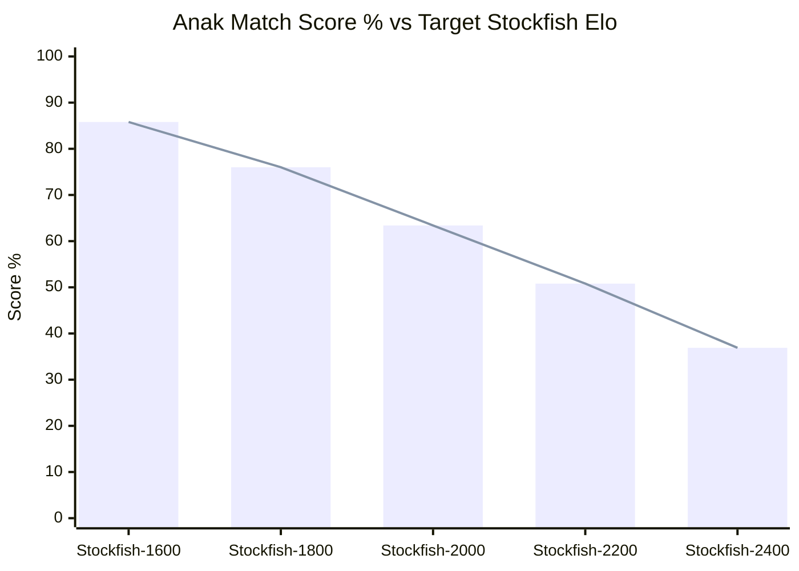
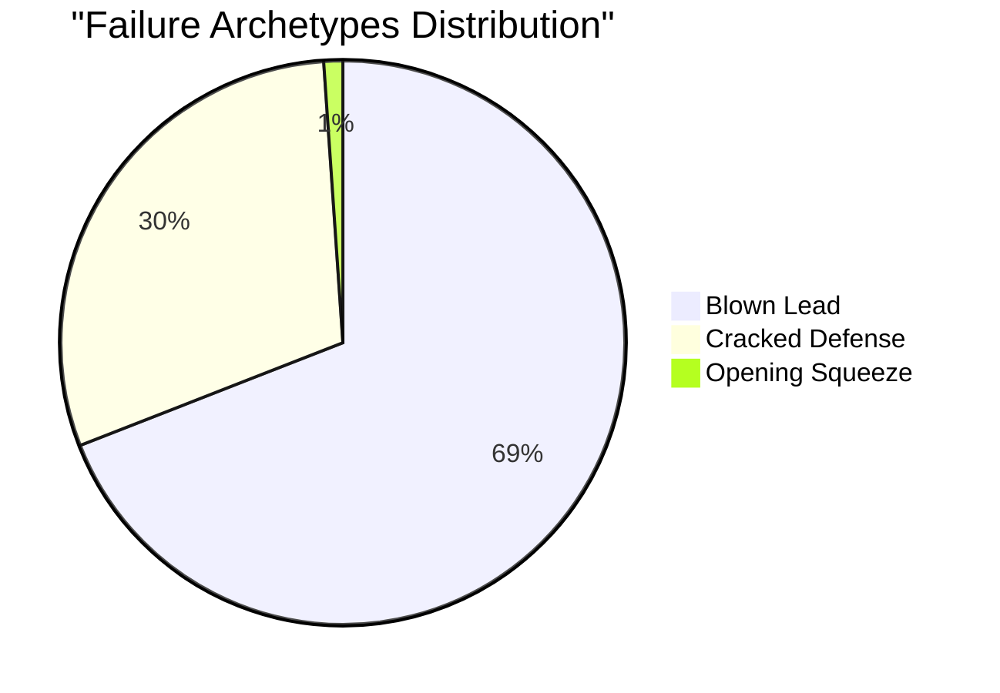
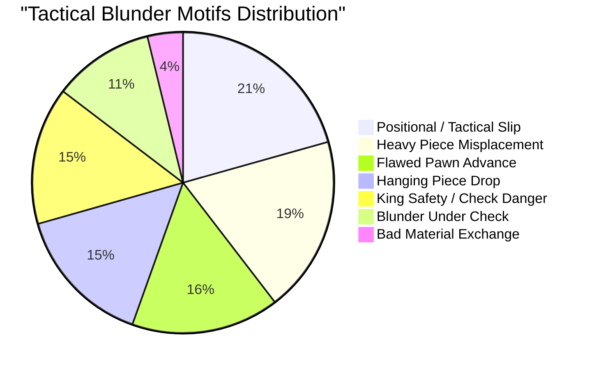
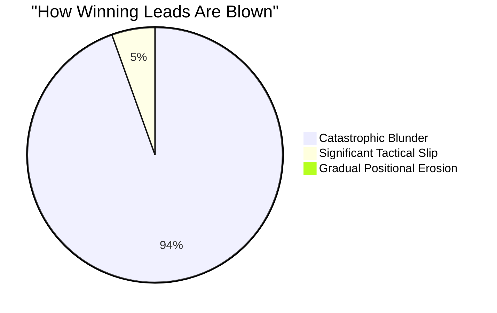
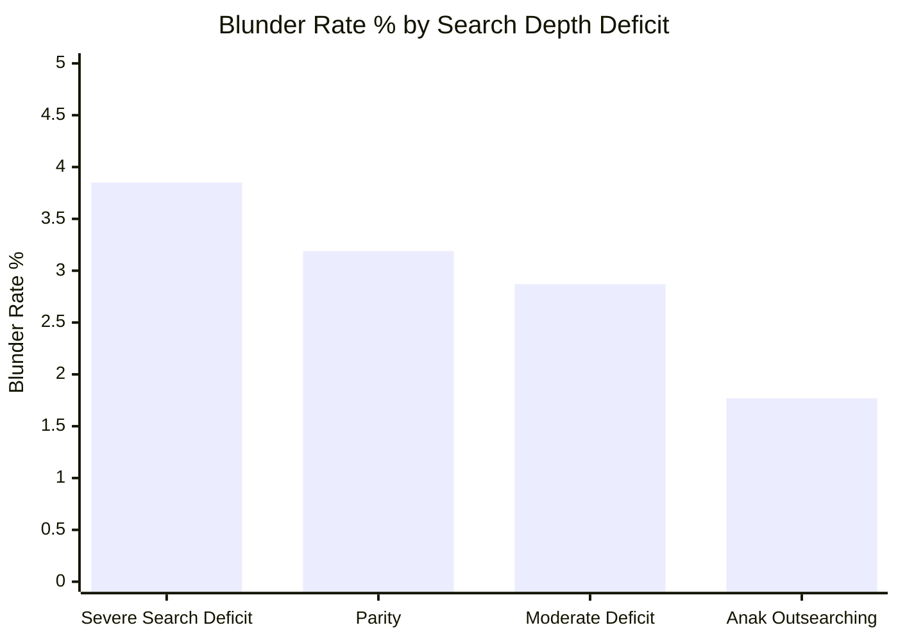
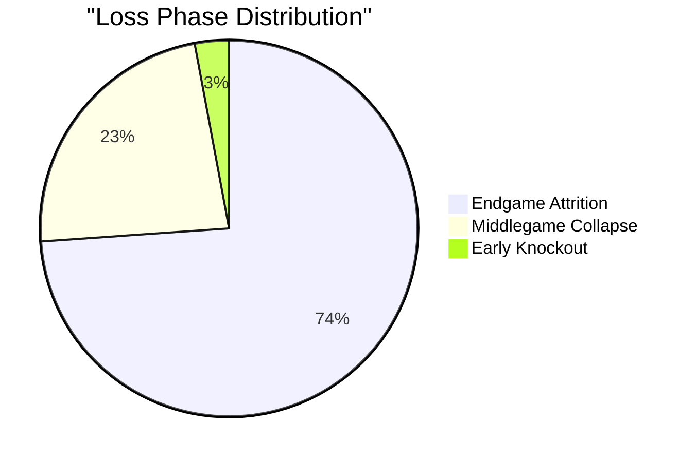

# Anak Weakness Finder — Comprehensive Diagnostic & Big-Data Report

## 1. Automated Stockfish Ladder Progression

| Opponent | Target Elo | Games | Score | W / L / D | Status |
| :--- | :---: | :---: | :---: | :---: | :---: |
| **Stockfish-1600** | 1600 | 10,000 | **85.80000305175781%** | 8,461 / 1,298 / 241 | Passed (>= 50%) |
| **Stockfish-1800** | 1800 | 10,000 | **76.0%** | 7,372 / 2,173 / 455 | Passed (>= 50%) |
| **Stockfish-2000** | 2000 | 10,000 | **63.400001525878906%** | 6,026 / 3,346 / 628 | Passed (>= 50%) |
| **Stockfish-2200** | 2200 | 10,000 | **50.79999923706055%** | 4,661 / 4,502 / 837 | Passed (>= 50%) |
| **Stockfish-2400** | 2400 | 10,000 | **36.900001525878906%** | 3,176 / 5,788 / 1,036 | **Ceiling Reached** |

## 2. White vs. Black Color Disparity Analysis

| Color | Total Games | Win Rate | W / L / D | Thrown Wins | Cracked Defenses | Avg Loss Ply |
| :--- | :---: | :---: | :---: | :---: | :---: | :---: |
| **White** | 25,000 | **68.4%** | 16,352 / 7,133 / 1,515 | 6,228 | 905 | 103.7 |
| **Black** | 25,000 | **56.7%** | 13,344 / 9,974 / 1,682 | 5,587 | 4,201 | 97.2 |

> [!WARNING]
> **Color Asymmetry Gap**: `+11.7%` (White Score: 68.4% vs Black Score: 56.7%).

## 3. Failure Archetype Breakdown: Blown Leads vs. Defense Collapses

| Failure Archetype | Total Games | % of Losses | White | Black | Black/White Ratio | Avg Loss Ply | Avg Blunder Drop |
| :--- | :---: | :---: | :---: | :---: | :---: | :---: | :---: |
| **Blown Lead (Eval >= +1.50 -> Loss)** | 11,815 | **69.1%** | 6,228 | **5,587** | `0.90x` | 105.5 | `-24.70 cp` |
| **Cracked Defense (Equal -> Loss)** | 5,106 | **29.8%** | 905 | **4,201** | `4.64x` | 88.1 | `-21.90 cp` |
| **Missed Win (Lead Blown to Draw)** | 2,895 | **16.9%** | 1,458 | **1,437** | `0.99x` | 178.9 | `-3.55 cp` |
| **Opening Squeeze (Never Equal -> Loss)** | 186 | **1.1%** | 0 | **186** | - | 70.3 | `-22.65 cp` |

## 4. Endgame Material & Piece Taxonomy Vulnerability

| Endgame Archetype | Total Games | Score % | W / L / D | Black Losses | Thrown Wins | Cracked Defenses | Avg Loss Ply |
| :--- | :---: | :---: | :---: | :---: | :---: | :---: | :---: |
| **Queen & Pieces** | 27,613 | **64.7%** | 17,473 / 9,330 / 810 | **5,515** | 6,270 | 2,944 | 75.8 |
| **Rook & Minor Pieces** | 12,763 | **68.3%** | 8,374 / 3,714 / 675 | **2,155** | 2,400 | 1,260 | 118.3 |
| **Rook & Pawn** | 4,181 | **47.3%** | 1,620 / 1,848 / 713 | **1,049** | 1,477 | 360 | 141.0 |
| **Bishop Endgame** | 1,225 | **37.6%** | 386 / 689 / 150 | **401** | 524 | 164 | 137.6 |
| **Queen & Pawn** | 1,039 | **48.9%** | 430 / 453 / 156 | **249** | 365 | 87 | 120.0 |
| **Pure King & Pawn** | 992 | **57.7%** | 429 / 277 / 286 | **156** | 224 | 52 | 125.8 |
| **Knight Endgame** | 920 | **50.3%** | 402 / 396 / 122 | **211** | 317 | 77 | 137.7 |
| **Mixed Minor Pieces** | 536 | **46.7%** | 234 / 269 / 33 | **161** | 166 | 103 | 167.8 |
| **Bishop vs Knight** | 348 | **69.4%** | 200 / 65 / 83 | **35** | 37 | 28 | 141.8 |
| **Opposite-Colored Bishops** | 279 | **56.8%** | 81 / 43 / 155 | **26** | 26 | 17 | 151.4 |
| **Same-Colored Bishops** | 104 | **71.2%** | 67 / 23 / 14 | **16** | 9 | 14 | 128.6 |

## 5. Tactical Blunder Motifs & Failure Classifications

| Blunder Motif | Total Blunders | % of Blunders | White | Black | Avg Eval Drop | Avg Ply |
| :--- | :---: | :---: | :---: | :---: | :---: | :---: |
| **Positional / Tactical Slip** | 13,813 | **20.6%** | 6,218 | **7,595** | `-7.21 cp` | 86.9 |
| **Heavy Piece Misplacement** | 12,690 | **19.0%** | 5,972 | **6,718** | `-5.25 cp` | 60.4 |
| **Flawed Pawn Advance** | 10,624 | **15.9%** | 4,855 | **5,769** | `-6.94 cp` | 56.2 |
| **Hanging Piece Drop** | 10,131 | **15.1%** | 4,454 | **5,677** | `-13.99 cp` | 57.2 |
| **King Safety / Check Danger** | 9,899 | **14.8%** | 4,701 | **5,198** | `-6.69 cp` | 80.4 |
| **Blunder Under Check** | 7,251 | **10.8%** | 3,179 | **4,072** | `-14.69 cp` | 83.3 |
| **Bad Material Exchange** | 2,544 | **3.8%** | 1,141 | **1,403** | `-9.97 cp` | 49.3 |

## 6. Lead Bleed Dynamics: How Winning Advantages Are Blown

| Bleed Mode | Thrown Games | % of Thrown | Avg Peak Lead | White | Black | Avg Worst Drop | Avg Loss Ply |
| :--- | :---: | :---: | :---: | :---: | :---: | :---: | :---: |
| **Catastrophic Blunder (Drop >= 2.5 cp)** | 11,129 | **94.2%** | `+3.39 cp` | 5,845 | **5,284** | `-26.10 cp` | 104.0 |
| **Significant Tactical Slip (Drop 1.5 - 2.5 cp)** | 646 | **5.5%** | `+2.49 cp` | 364 | **282** | `-2.12 cp` | 129.5 |
| **Gradual Positional Erosion** | 40 | **0.3%** | `+2.09 cp` | 19 | **21** | `-1.32 cp` | 128.8 |

## 7. NNUE Expert Transition Boundaries & Jumps

### NNUE Expert Switches per Game Distribution

| Expert Switches in Game | Total Games | % of Games | Cumulative % | Game Flow Dynamic |
| :---: | :---: | :---: | :---: | :--- |
| **0 switches** | 2,748 | **5.50%** | 5.50% | Single-expert game (no transitions) |
| **1 switch** | 7,324 | **14.65%** | 20.15% | Standard phase transition |
| **2 switches** | 10,201 | **20.40%** | 40.55% | Standard phase transition |
| **3 switches** | 10,146 | **20.29%** | 60.84% | Standard phase transition |
| **4 switches** | 8,459 | **16.92%** | 77.76% | Frequent phase fluctuation |
| **5 switches** | 5,881 | **11.76%** | 89.52% | Frequent phase fluctuation |
| **6 switches** | 3,312 | **6.62%** | 96.14% | Frequent phase fluctuation |
| **7 switches** | 1,408 | **2.82%** | 98.96% | Heavy tactical oscillation / multi-phase |
| **8 switches** | 422 | **0.84%** | 99.80% | Heavy tactical oscillation / multi-phase |
| **9 switches** | 77 | **0.15%** | 99.95% | Heavy tactical oscillation / multi-phase |
| **10 switches** | 18 | **0.04%** | 99.99% | Heavy tactical oscillation / multi-phase |
| **11 switches** | 4 | **0.01%** | 100.00% | Heavy tactical oscillation / multi-phase |

> [!NOTE]
> **Transition Frequency Summary**: In **94.5%** of games, Anak switches NNUE experts at least once. The average game experiences **3.11** expert switches (Median: **3.0**), with 72.3% of all games containing 2 to 5 model transitions.

### Top Transition Handoff Pairs

| Handoff Pair | From Expert | To Expert | Transitions | Blunders | Blunder Rate % | Avg Swing |
| :--- | :--- | :--- | :---: | :---: | :---: | :---: |
| **Attack -> Endgame** | `Attack` | `Endgame` | 170 | 40 | **23.53%** | `±1.85 cp` |
| **Queenless -> Imbalance** | `Queenless` | `Imbalance` | 189 | 43 | **22.75%** | `±2.71 cp` |
| **Open -> Endgame** | `Open` | `Endgame` | 939 | 157 | **16.72%** | `±2.31 cp` |
| **Imbalance -> Endgame** | `Imbalance` | `Endgame` | 4,149 | 543 | **13.09%** | `±2.62 cp` |
| **Attack -> Imbalance** | `Attack` | `Imbalance` | 5,050 | 598 | **11.84%** | `±1.62 cp` |
| **Open -> Imbalance** | `Open` | `Imbalance` | 30,746 | 2,679 | **8.71%** | `±1.21 cp` |
| **Imbalance -> Attack** | `Imbalance` | `Attack` | 6,029 | 401 | **6.65%** | `±1.14 cp` |
| **Queenless -> Endgame** | `Queenless` | `Endgame` | 6,664 | 424 | **6.36%** | `±0.99 cp` |
| **Attack -> Open** | `Attack` | `Open` | 261 | 16 | **6.13%** | `±2.02 cp` |
| **Imbalance -> Open** | `Imbalance` | `Open` | 42,434 | 1,875 | 4.42% | `±0.83 cp` |
| **Closed -> Imbalance** | `Closed` | `Imbalance` | 11,074 | 345 | 3.12% | `±0.61 cp` |
| **Closed -> Open** | `Closed` | `Open` | 9,998 | 200 | 2.0% | `±0.57 cp` |
| **Open -> Attack** | `Open` | `Attack` | 1,902 | 29 | 1.52% | `±0.83 cp` |
| **Imbalance -> Queenless** | `Imbalance` | `Queenless` | 13,069 | 173 | 1.32% | `±0.49 cp` |
| **Imbalance -> Closed** | `Imbalance` | `Closed` | 16,312 | 183 | 1.12% | `±0.38 cp` |

## 8. Search Depth Deficit & Blunder Rate Correlation

| Depth Deficit Tier | Plies Played | Blunders | Blunder Rate % | Avg Anak Depth | Avg Opp Depth | Avg Time/Move |
| :--- | :---: | :---: | :---: | :---: | :---: | :---: |
| **Severe Search Deficit (5+ plies behind)** | 1,007,990 | 38,797 | **3.85%** | 6.1 | 12.4 | `0.02s` |
| **Parity (Within 1 ply)** | 61,666 | 1,967 | **3.19%** | 7.6 | 8.3 | `0.021s` |
| **Moderate Deficit (2-4 plies behind)** | 904,320 | 25,939 | 2.87% | 6.6 | 9.9 | `0.023s` |
| **Anak Outsearching (+2 or more plies)** | 14,098 | 249 | 1.77% | 89.7 | 12.4 | `0.005s` |

## 9. NNUE Expert Model Vulnerability Breakdown (Middlegame Phase)

| Active NNUE Expert | Middlegame Games | Score % | Wins | Losses | Draws | Losses as White | Losses as Black | Thrown Wins | Cracked Defenses |
| :--- | :---: | :---: | :---: | :---: | :---: | :---: | :---: | :---: | :---: |
| **Attack** | 3,065 | **53.1%** | 1,531 | 1,344 | 190 | 645 | **699** | 934 | 395 |
| **Endgame** | 19 | **55.3%** | 8 | 6 | 5 | 1 | **5** | 3 | 3 |
| **Closed** | 6,196 | **56.0%** | 3,277 | 2,532 | 387 | 1,235 | **1,297** | 1,753 | 757 |
| **Open** | 14,636 | **57.9%** | 7,910 | 5,593 | 1,133 | 2,404 | **3,189** | 3,981 | 1,572 |
| **Imbalance** | 15,617 | **64.4%** | 9,712 | 5,217 | 688 | 1,932 | **3,285** | 3,570 | 1,578 |
| **Queenless** | 9,215 | **69.9%** | 6,047 | 2,382 | 786 | 905 | **1,477** | 1,564 | 780 |

## 10. Game Phase at Failure (When are Games Lost?)

| Phase | Total Losses | % of Losses | White Losses | Black Losses | Black vs White Ratio | Avg Ply |
| :--- | :---: | :---: | :---: | :---: | :---: | :---: |
| **Endgame Attrition (Ply > 60)** | 12,642 | **73.9%** | 5,609 | **7,033** | `1.3x` | 119.3 |
| **Middlegame Collapse (Ply 31-60)** | 3,965 | **23.2%** | 1,409 | **2,556** | `1.8x` | 47.5 |
| **Early Knockout (Ply <= 30)** | 500 | **2.9%** | 115 | **385** | `3.3x` | 25.4 |

## 11. Opening Families & Pawn Structure Vulnerability Matrix

| Opening Family | Pawn Structure Archetype | Games | Score % | W / L / D | Black Losses | Avg Loss Ply |
| :--- | :--- | :---: | :---: | :---: | :---: | :---: |
| **King's Indian Setup** | Locked Center Ram (d5 vs e5/c5) | 62 | **42.7%** | 24 / 33 / 5 | 16 | 86.5 |
| **Queen's Gambit** | Queen's Gambit Tension (c4-d4 vs d5) | 90 | **59.4%** | 52 / 35 / 3 | 20 | 114.7 |
| **Open Game (1.e4 e5)** | Open Center (e4 vs e5) | 1,166 | **59.8%** | 655 / 427 / 84 | 249 | 94.9 |
| **Flank / Uncommon Opening** | Symmetrical / Flank | 162 | **60.2%** | 90 / 57 / 15 | 36 | 98.1 |
| **Queen's Indian Defense** | Queen's Pawn Structure | 970 | **60.3%** | 551 / 351 / 68 | 207 | 95.5 |
| **Ruy Lopez** | Open Center (e4 vs e5) | 146 | **60.6%** | 83 / 52 / 11 | 30 | 94.8 |
| **English Opening** | English Flank (c4 vs e5/c5) | 3,018 | **61.2%** | 1,750 / 1,074 / 194 | 620 | 102.7 |
| **King's Indian Defense** | Locked Center Ram (d5 vs e5/c5) | 2,546 | **61.4%** | 1,479 / 900 / 167 | 500 | 101.8 |
| **French Defense** | French Pawn Chain (d4-e5 vs d5-e6) | 5,374 | **61.6%** | 3,148 / 1,902 / 324 | 1,130 | 95.8 |
| **Queen's Pawn Game** | Queen's Pawn Structure | 5,072 | **62.0%** | 2,974 / 1,752 / 346 | 1,046 | 99.5 |
| **Sicilian Defense** | Sicilian Asymmetry (c5 vs d4) | 15,436 | **62.3%** | 9,143 / 5,357 / 936 | 3,098 | 100.0 |
| **Flank / Uncommon Opening** | Fluid Center | 5,112 | **63.6%** | 3,076 / 1,685 / 351 | 989 | 101.7 |
| **Scotch Game / Center Game** | Open Center (e4 vs e5) | 1,696 | **63.9%** | 1,034 / 563 / 99 | 312 | 104.8 |
| **Modern / Pirc Setup** | Queen's Pawn Structure | 4,860 | **64.7%** | 2,993 / 1,561 / 306 | 910 | 101.0 |
| **Caro-Kann Defense** | Caro-Kann Pawn Structure (c6-d5) | 1,992 | **64.9%** | 1,228 / 636 / 128 | 383 | 99.3 |

## 12. High-Priority Weak Opening FEN Lines (0% to 10% Score)

| Opening Line | ECO | Score % | W / L / D | Avg Loss Ply | Starting Board FEN |
| :--- | :---: | :---: | :---: | :---: | :--- |
| **Sicilian Defense: Scheveningen** | `B80` | **0.0%** | 0 / 6 / 0 | 76.5 | `r2qk2r/pb1pbppp/2n1pn2/2p5/4P3/2PB1...` |
| **Sicilian Defense** | `B20` | **0.0%** | 0 / 6 / 0 | 121.7 | `rn1qkb1r/pb3ppp/3p1n2/2pP4/2B5/2N5/...` |
| **Queen's Pawn Game** | `A40` | **0.0%** | 0 / 6 / 0 | 128.8 | `rnbqk2r/1pp2ppp/4p3/p7/2pPn3/5NP1/P...` |
| **Modern / Pirc Setup** | `A40` | **8.3%** | 0 / 5 / 1 | 110.8 | `r1bqk1nr/2pn1pb1/p2pp1p1/1p5p/3PP2P...` |
| **Sicilian Defense: Paulsen / Kan** | `B40` | **8.3%** | 0 / 5 / 1 | 86.0 | `r1bqk2r/1p1nbppp/p2ppn2/8/3NP3/2N1B...` |
| **Sicilian Defense: Scheveningen** | `B80` | **8.3%** | 0 / 5 / 1 | 133.6 | `r2qkb1r/pp1nnppp/4p1b1/2ppP3/3P3N/2...` |
| **Modern / Pirc Setup** | `A40` | **16.7%** | 1 / 5 / 0 | 98.0 | `rnbq1rk1/ppp1ppbp/6p1/3pP3/3P1PP1/2...` |
| **Sicilian Defense: Dragon** | `B70` | **16.7%** | 1 / 5 / 0 | 130.2 | `r1bq1rk1/pp1nppbp/3p1np1/2p5/2PPP3/...` |
| **King's Indian Defense** | `E60` | **16.7%** | 1 / 5 / 0 | 123.6 | `rnbq1rk1/pp3pbp/2pp2p1/3Pp2n/2P1P3/...` |
| **Sicilian Defense: Paulsen / Kan** | `B40` | **16.7%** | 1 / 5 / 0 | 94.4 | `r3kbnr/1pqb1ppp/p1npp3/8/3NPP2/2N1B...` |
| **Queen's Pawn Game** | `A40` | **16.7%** | 1 / 5 / 0 | 106.8 | `r1b1k2r/ppp1qppp/2n1pn2/8/2pP4/P1B2...` |
| **Modern / Pirc Setup** | `A40` | **16.7%** | 1 / 5 / 0 | 95.4 | `r2qk2r/ppp1ppbp/1nn3p1/8/3P2b1/2N2N...` |
| **French Defense** | `C00` | **16.7%** | 1 / 5 / 0 | 99.4 | `r2q1rk1/pppb1ppp/2nbpn2/3p4/1PPP4/P...` |
| **Sicilian Defense: Dragon** | `B70` | **16.7%** | 1 / 5 / 0 | 69.4 | `r1bq1rk1/pp2pp1p/2np2pn/8/2PNP3/2N5...` |
| **Sicilian Defense: Scheveningen** | `B80` | **16.7%** | 1 / 5 / 0 | 76.8 | `rn1qkb1r/pb3ppp/1pnpp3/8/2PNP3/2N3P...` |

## 13. Full-Power Stockfish Oracle Ground-Truth Audit (Depth 9 & 20)

| Game ID | Ply | Active NNUE | Anak Eval | ST9 Eval (ce) | ST9 Best Move | ST20 True Eval | Eval Error | Failure Classification | Board FEN |
| :--- | :---: | :---: | :---: | :---: | :---: | :---: | :---: | :--- | :--- |
| `tier_sf1800_1793043025_g5120` | 40 | `Imbalance` | **-98.00** | `9900 cp` | **f8e8** | **+99.00** | `197.00` | **Lead Blown (Imbalance)** | `5rk1/2q2p1p/p2b1P1Q/3P2P1/2p...` |
| `tier_sf2400_1793047759_g9517` | 60 | `Imbalance` | **-98.00** | `9900 cp` | **h8g7** | **+99.00** | `197.00` | **Lead Blown (Imbalance)** | `4Q2k/1q3p1p/5Np1/r5P1/p2p3P/...` |
| `tier_sf2000_1793044475_g9214` | 246 | `Endgame` | **-98.00** | `9900 cp` | **f5c8** | **+99.00** | `197.00` | **Lead Blown (Endgame)** | `1R5k/7P/7K/5b2/8/8/8/8 b - -...` |
| `tier_sf2200_1793046065_g6706` | 34 | `Imbalance` | **-98.00** | `9900 cp` | **a4c5** | **+99.00** | `197.00` | **Lead Blown (Imbalance)** | `3rqrk1/2p2p1p/1pn1pP1Q/8/n1b...` |
| `tier_sf2400_1793047759_g3439` | 200 | `Endgame` | **-98.00** | `9900 cp` | **f6a6** | **+99.00** | `197.00` | **Lead Blown (Endgame)** | `R7/1R6/5r2/8/k7/8/4K3/8 b - ...` |
| `tier_sf2400_1793047759_g2714` | 96 | `Endgame` | **-98.00** | `9900 cp` | **b4b3** | **+99.00** | `197.00` | **Lead Blown (Endgame)** | `8/7r/6p1/6Bk/1p3P2/5K1b/1b6/...` |
| `tier_sf2200_1793046065_g74` | 30 | `Imbalance` | **-98.00** | `9900 cp` | **d8d6** | **+99.00** | `197.00` | **Lead Blown (Imbalance)** | `r2r2k1/pp3p1p/3R1PpQ/2p5/7P/...` |
| `tier_sf2200_1793046065_g3574` | 76 | `Imbalance` | **-98.00** | `9900 cp` | **e5d4** | **+99.00** | `197.00` | **Lead Blown (Imbalance)** | `2r2r2/8/p3Qp2/4k3/1p1N4/P4p2...` |
| `tier_sf2400_1793047759_g6606` | 30 | `Imbalance` | **-98.00** | `9900 cp` | **c6c5** | **+99.00** | `197.00` | **Lead Blown (Imbalance)** | `r3r1k1/pp3p1p/q1p2BpQ/8/2PNp...` |
| `tier_sf1600_1793041700_g8106` | 38 | `Imbalance` | **-98.00** | `9900 cp` | **g8h8** | **+99.00** | `197.00` | **Lead Blown (Imbalance)** | `r3qrk1/1p3p1p/2nbpPpQ/1R1pn1...` |
| `tier_sf2200_1793046065_g1878` | 58 | `Imbalance` | **-98.00** | `9900 cp` | **c3c2** | **+99.00** | `197.00` | **Lead Blown (Imbalance)** | `7R/2q2pQ1/6pp/4p1Nk/4P2P/1bp...` |
| `tier_sf2200_1793046065_g4789` | 176 | `Endgame` | **-98.00** | `9900 cp` | **b4f8** | **+99.00** | `197.00` | **Lead Blown (Endgame)** | `2R4k/8/5KP1/8/1b6/8/8/8 b - ...` |
| `tier_sf2400_1793047759_g2377` | 46 | `Imbalance` | **-98.00** | `9900 cp` | **f8g8** | **+99.00** | `197.00` | **Lead Blown (Imbalance)** | `5r2/3q1p1k/1rn1pP2/1p4Q1/2Pp...` |
| `tier_sf2200_1793046065_g7156` | 196 | `Endgame` | **-98.00** | `9900 cp` | **f2a7** | **+99.00** | `197.00` | **Lead Blown (Endgame)** | `R7/8/8/8/2K5/k1B5/5b2/8 b - ...` |
| `tier_sf2000_1793044475_g3682` | 50 | `Queenless` | **-98.00** | `9900 cp` | **c4c3** | **+99.00** | `197.00` | **Lead Blown (Queenless)** | `2b1B3/8/1r2pRpp/pp5k/2p2PpP/...` |
| `tier_sf2200_1793046065_g6638` | 38 | `Imbalance` | **-98.00** | `9900 cp` | **b4e1** | **+99.00** | `197.00` | **Lead Blown (Imbalance)** | `r4rk1/2pb1p2/4pQpB/p3P2P/1qn...` |
| `tier_sf1600_1793041700_g6815` | 36 | `Queenless` | **-98.00** | `9900 cp` | **d7b8** | **+99.00** | `197.00` | **Lead Blown (Queenless)** | `1Rkr3r/p2n2R1/3B1n1p/2pP4/2P...` |
| `tier_sf2400_1793047759_g7517` | 22 | `Imbalance` | **-98.00** | `9900 cp` | **g3h5** | **+99.00** | `197.00` | **Lead Blown (Imbalance)** | `r1b2rBk/pp2qpp1/1b6/7R/5P1P/...` |
| `tier_sf1800_1793043025_g2400` | 32 | `Imbalance` | **-98.00** | `9900 cp` | **f8d8** | **+99.00** | `197.00` | **Lead Blown (Imbalance)** | `rnq2rk1/1p3p2/4p1pQ/p3P3/b2R...` |
| `tier_sf2200_1793046065_g7427` | 98 | `Queenless` | **-98.00** | `9900 cp` | **f4f3** | **+99.00** | `197.00` | **Lead Blown (Queenless)** | `8/5N2/1n2R2p/1P1p1p1k/r2P1p2...` |
| `tier_sf2200_1793046065_g4494` | 46 | `Imbalance` | **-98.00** | `9900 cp` | **f7g6** | **+99.00** | `197.00` | **Lead Blown (Imbalance)** | `4rrk1/pp3b1p/2p3R1/1q6/1P1Q4...` |
| `tier_sf2400_1793047759_g4593` | 42 | `Imbalance` | **-98.00** | `9900 cp` | **g7g6** | **+99.00** | `197.00` | **Lead Blown (Imbalance)** | `r4rk1/qb3ppp/5B2/ppp2N1P/Pn1...` |
| `tier_sf2400_1793047759_g8029` | 354 | `Endgame` | **-98.00** | `9900 cp` | **d8e8** | **+99.00** | `197.00` | **Lead Blown (Endgame)** | `3k4/8/3KB3/6R1/8/8/8/8 b - -...` |
| `tier_sf1600_1793041700_g2038` | 54 | `Imbalance` | **-98.00** | `9900 cp` | **g8h7** | **+99.00** | `197.00` | **Lead Blown (Imbalance)** | `4r1k1/p6P/3pN3/3P2Q1/q1p1p3/...` |
| `tier_sf1600_1793041700_g6211` | 32 | `Imbalance` | **-98.00** | `9900 cp` | **h8g8** | **+99.00** | `197.00` | **Lead Blown (Imbalance)** | `r4rRk/pp3p2/2p2Q1P/4p3/P3n3/...` |
| `tier_sf2400_1793047759_g3491` | 72 | `Endgame` | **-98.00** | `9900 cp` | **f2f1q** | **+99.00** | `197.00` | **Lead Blown (Endgame)** | `6k1/5p1p/5K2/R4Bp1/4p3/4P2P/...` |
| `tier_sf1800_1793043025_g3745` | 32 | `Imbalance` | **-98.00** | `9900 cp` | **b7c8** | **+99.00** | `197.00` | **Lead Blown (Imbalance)** | `5b1k/rb3p2/npn1pP2/p2p2NP/8/...` |
| `tier_sf1600_1793041700_g1775` | 28 | `Imbalance` | **-98.00** | `9900 cp` | **f7g6** | **+99.00** | `197.00` | **Lead Blown (Imbalance)** | `rnbq1rk1/1p3p2/2n1p1P1/Pp1pP...` |
| `tier_sf2200_1793046065_g9558` | 34 | `Imbalance` | **-98.00** | `9900 cp` | **d8g5** | **+99.00** | `197.00` | **Lead Blown (Imbalance)** | `2rq1rk1/p4p2/1n2p1p1/3pP1P1/...` |
| `tier_sf2000_1793044475_g7494` | 220 | `Endgame` | **-98.00** | `9900 cp` | **c8b8** | **+99.00** | `197.00` | **Lead Blown (Endgame)** | `2kb1R2/8/2K5/1N6/8/8/8/8 b -...` |
| `tier_sf2400_1793047759_g5141` | 136 | `Endgame` | **-98.00** | `9900 cp` | **f8g8** | **+99.00** | `197.00` | **Lead Blown (Endgame)** | `5k2/3P4/5K2/8/8/3B4/8/8 b - ...` |
| `tier_sf1600_1793041700_g6007` | 40 | `Open` | **-98.00** | `9900 cp` | **c6f3** | **+99.00** | `197.00` | **Lead Blown (Open)** | `5rk1/2p2p1p/1pb2PpQ/4p3/2P5/...` |
| `tier_sf1800_1793043025_g512` | 244 | `Endgame` | **-98.00** | `9900 cp` | **e1h4** | **+99.00** | `197.00` | **Lead Blown (Endgame)** | `8/8/7k/4BK2/8/8/7R/4b3 b - -...` |
| `tier_sf1800_1793043025_g6117` | 34 | `Open` | **-98.00** | `9900 cp` | **b1b2** | **+99.00** | `197.00` | **Lead Blown (Open)** | `2r3k1/3b1p1p/p3pPpQ/3p4/2p5/...` |
| `tier_sf2400_1793047759_g326` | 208 | `Endgame` | **-98.00** | `9900 cp` | **c8b8** | **+99.00** | `197.00` | **Lead Blown (Endgame)** | `2k5/5Q2/2K5/8/8/8/7b/8 b - -...` |

